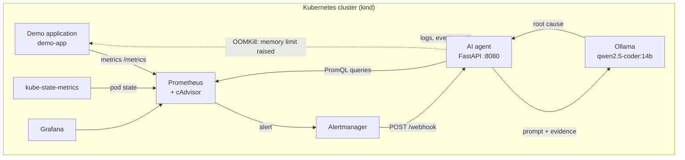
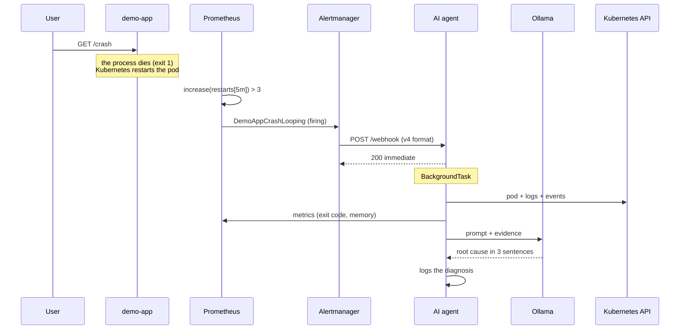
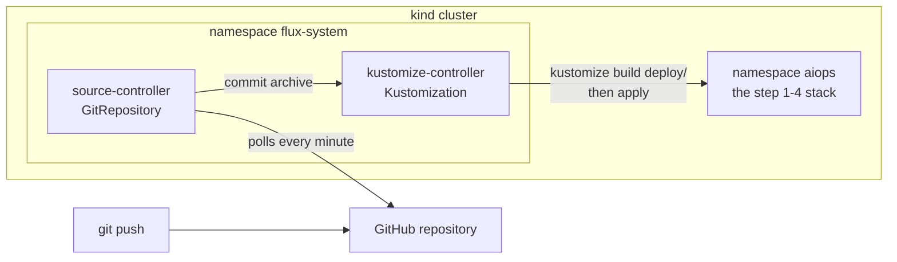
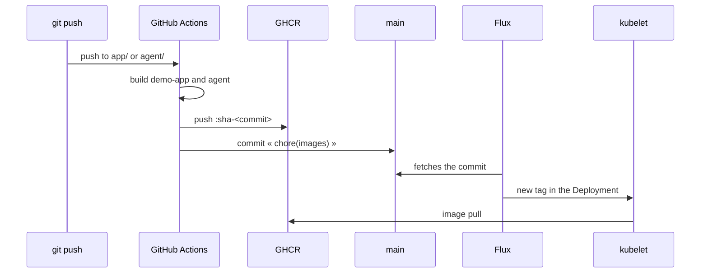

[🇫🇷 Version française](README.md)

# K8s AI Ops Agent — Diagnosing and self-healing Kubernetes incidents with a local AI agent

> **Work in progress — steps 1 to 6 complete.**
> Built as a learning project to understand every building block from end to end.

[](https://github.com/Abi0066/k8s-aiops-agent/actions/workflows/agent-ci.yml)
[](https://github.com/Abi0066/k8s-aiops-agent/actions/workflows/infra-ci.yml)
[](https://github.com/Abi0066/k8s-aiops-agent/actions/workflows/images-release.yml)

**Table of contents** — [Overview](#overview) · [The problem](#the-problem) ·
[Architecture](#architecture) · [Prerequisites](#prerequisites) ·
[Quick start](#quick-start) · [GitOps](#gitops-deployment) ·
[CI/CD](#image-cicd) · [Agent configuration](#agent-configuration) ·
[Tests](#tests-and-checks) · [Layout](#repository-layout) ·
[Steps](#project-steps) · [Technical choices](#technical-choices-and-rationale) ·
[Troubleshooting](#troubleshooting) · [Limitations](#known-limitations) · [License](#license).

## The problem

When a Kubernetes application crashes, the diagnostic chain is still manual
today: you look at `kubectl describe pod`, dig through the logs, cross-check
with Grafana, and guess. On a real production incident, this work takes
minutes — and night on-call adds extra mental load.

This project automates the *diagnosis* part: a local AI agent receives the
alerts, collects the evidence (logs, events, metrics, pod state) and proposes
a root cause. Since step 4, it also fixes by itself the incident it can settle
with certainty (a container killed for exceeding its memory limit) — in
`dry-run` mode by default, never writing directly without a human decision.

## Overview

**The dashboard** aggregates the signals the agent collects: requests,
restarts, memory, pod status, latency, CPU. The memory spikes correspond to
the OOMKills triggered by the demo.


**Detection** — Prometheus loads the three rule groups. A single OOMKill is
enough to move `DemoAppOOMKilled` to `FIRING`, without waiting for a restart
loop.


**Diagnosis** — the agent cross-checks the evidence, settles on `OOMKilled`
with `high` confidence, and prepares a `128Mi → 192Mi` patch. In `dry-run`,
the API server validates the patch without recording it: the limit stays
`128Mi` and no annotation is written.


**The full loop** — four crashes, the pod state, the wait for the alert, then
the agent's verdict. The recording is sped up: the visible pause corresponds
to the rule's `for: 1m` and to the local LLM inference.


## Architecture



The path of an incident, end to end:



> The agent answers `200` **before** analyzing anything. Alertmanager has a
> 10 s timeout; without this immediate response, it would cut the connection
> and retry in a loop. The processing happens in a FastAPI `BackgroundTask`.

## Prerequisites

| Need | Version | Why |
|---|---|---|
| Podman **or** Docker | Podman 3.0+ / Docker 20.10+ | Container runtime for `kind` |
| `br_netfilter` | kernel | Routes pod traffic through iptables. Without it, the internal K8s network is broken |
| inotify instances | kernel, at least 512 | containerd opens one per container to be notified of OOMKills. At the default value (128), the session may already have consumed them: containerd can no longer subscribe, a pod killed for lack of memory appears as `Error` instead of `OOMKilled`, and self-healing does not trigger. The current value can be read with `cat /proc/sys/fs/inotify/max_user_instances` |
| `make` | — | Script entry point |
| Python | 3.12 | Optional: local tests and lint (`make test lint`) |
| Free RAM | ~12 GB | Ollama loads a 14-billion-parameter model |
| Disk space | ~15 GB | images, load archives and the Ollama model |
| Network access | `ghcr.io` (and `github.com` for GitOps) | the kubelet pulls images from the registry; without network, `make build` becomes necessary |

On Fedora:

```bash
sudo modprobe br_netfilter
echo br_netfilter | sudo tee /etc/modules-load.d/k8s.conf
sudo sysctl -w fs.inotify.max_user_instances=512
echo fs.inotify.max_user_instances=512 | sudo tee /etc/sysctl.d/99-kind.conf
systemctl --user enable --now podman.socket
```

## Quick start

```bash
make setup        # installs kind + kubectl into ~/.local/bin (no root)
make cluster-up   # creates the cluster and deploys the stack (images pulled from GHCR)
make demo-crash   # triggers an incident and shows the diagnosis
```

`make gitops-up` replaces `make cluster-up` for a Git-driven deployment: see
[GitOps deployment](#gitops-deployment).

> **First start:** Ollama downloads the `qwen2.5-coder:14b` model (~9 GB)
> before it is ready. Allow several minutes depending on your connection; to
> follow the download:
> `kubectl -n aiops logs deploy/ollama -c pull-model -f`.
>
> **After a code change**, a `git push` to `main` is enough: GitHub Actions
> builds and publishes the images, then Flux deploys the new tag. To work
> offline, `make build` builds the manifest's tag and loads it into the node.

Then open:

| Service | URL | Credentials |
|---|---|---|
| Application | <http://localhost:30090/health> | — |
| Prometheus | <http://localhost:30093> | — |
| Grafana | <http://localhost:30094> | `admin` / `admin` |
| AI agent | <http://localhost:8080/docs> (after `port-forward`) | — |

The agent is **not** exposed on the host: it is an internal cluster service.
To see its interactive documentation (generated automatically by FastAPI):

```bash
kubectl -n aiops port-forward svc/aiops-agent 8080:8080
# then open http://localhost:8080/docs
```

## GitOps deployment

`make cluster-up` applies the manifests **from disk**: handy for development,
but what runs depends on who launched what, from which copy of the repository.
In GitOps, the cluster applies **what is in Git** itself. A change goes through
a commit, is reviewed in a pull request, and is undone with a `git revert`.

```bash
make gitops-up    # installs Flux, which deploys the stack from the main branch
make gitops-status
```



The two objects describing the sync are in
[`deploy/flux-sync.yaml`](deploy/flux-sync.yaml):

| Object | Role | Key setting |
|---|---|---|
| `GitRepository` | what to watch: a repository, a branch | `interval: 1m`: a push is deployed within a minute |
| `Kustomization` | what to apply: the `deploy/` folder | `prune: true`, `wait: true`, `interval: 5m` |

What these settings bring:

- **a single source of truth.** `deploy/kustomization.yaml` assembles
  `manifests/` and `monitoring/`. `make cluster-up` (`kubectl apply -k deploy`)
  and Flux apply exactly the same render;
- **drift correction.** Every 5 minutes, Flux reapplies Git even without a new
  commit. A manual `kubectl scale` or `kubectl edit` is undone: to change the
  cluster, you change Git;
- **cleanup (`prune`).** An object removed from Git is deleted from the
  cluster. With a plain `kubectl apply`, it would stay orphaned;
- **a verifiable state.** `make gitops-status` shows the applied commit
  (`Applied revision: main@sha1:…`); the Kustomization is `Ready` only when
  all objects are (`wait: true`), not merely accepted by the API.

The two behaviours that distinguish GitOps from a `kubectl apply` were
measured on the cluster, not just read in the configuration:

| Test | Command | Observed result |
|---|---|---|
| Drift correction | `kubectl -n aiops scale deploy/demo-app --replicas=3` | back to 1 replica in **311 s**, with no other action |
| `prune` | ConfigMap added then removed from Git | created by Flux, then deleted (`NotFound`) |

Drift is not corrected instantly: it waits for the next Kustomization cycle
(`interval: 5m`). That is the price of the interval — `make gitops-sync` forces
reconciliation when the wait is inconvenient.

To force a sync without waiting for the interval:

```bash
git push
make gitops-sync   # fetches the latest commit and applies it
```

To follow a fork, or a branch under review:

```bash
make gitops-up GITOPS_REPO_URL=https://github.com/<vous>/k8s-aiops-agent GITOPS_BRANCH=ma-branche
```

`flux-sync.yaml` is deliberately **not** synced by Flux itself: it would reset
the main repository URL on every cycle, and a fork could no longer deploy from
its own branch. The script applies it once, with the requested URL and branch.

> **Fork:** the image names (`ghcr.io/abi0066/…`) are hard-coded in the
> workflow and in the manifests. A fork must replace them with its own GHCR
> namespace, otherwise it will deploy this repository's images. The rest
> (URL and branch) is set with `GITOPS_REPO_URL` and `GITOPS_BRANCH`.

> **Images come from GHCR.** The kubelet pulls them from the registry
> (`imagePullPolicy: IfNotPresent`); `make build` remains the offline fallback.
> See [Image CI/CD](#image-cicd).

## Image CI/CD

Until step 5, a `git push` changed the manifests but not the executed code:
the images only lived on the machine. Step 6 closes the loop.



| Decision | Choice | Reason |
|---|---|---|
| Tag | immutable `sha-<7>` | a published tag never changes content; the image is tied to a commit |
| Manifest update | automatic commit by the CI | Flux stays at two controllers, no write token in the cluster |
| Visibility | public packages | the kubelet pulls without a secret; a private package would require an `imagePullSecret` |
| Local fallback | `make build` | builds the manifest tag and loads it into kind, to work offline |

The workflow (`.github/workflows/images-release.yml`) triggers on a push to
`main` touching `app/**`, `agent/**` or the workflow itself.
`workflow_dispatch` publishes without a code change. A pull request publishes
nothing: only commits on `main` produce images.

Two repository settings are needed, once:

- **Settings → Actions → General → Workflow permissions**: "Read and write
  permissions". Without it, the bump job cannot push its commit.
- **Package visibility**: public, so the kubelet pulls without an
  `imagePullSecret`.

Verified end to end: commit `642e773` produced image `sha-642e773`
(digest `sha256:d8bfa2…`), bump commit `0976317`, and the pod then in service
(`demo-app-6f84…`) answered with that image. The previous build
(`sha-c6591b9`) had a different digest: two commits, two distinct images.

Three pitfalls encountered, and what they teach:

- **A push made with `GITHUB_TOKEN` triggers no other workflow.** This is what
  prevents the bump commit from restarting the CI in a loop.
- **Editing a file in `.github/workflows/` requires the `workflow` scope** on
  the Git token, even with `repo`: GitHub protects workflow additions.
- **GHCR answers `401` to a raw `curl`, even for a public image.** The Docker
  Registry v2 protocol first asks for an anonymous token; the real test is
  `podman pull` while not logged in.

## Agent configuration

Everything is set through environment variables in
[`manifests/aiops-agent.yaml`](manifests/aiops-agent.yaml). The table gives the
code default; the manifest only departs from it for `AUTOHEAL_MEMORY_MAX`.

| Variable | Default | Role |
|---|---|---|
| `OLLAMA_URL` | `http://ollama.aiops.svc.cluster.local:11434` | model API |
| `PROMETHEUS_URL` | `http://prometheus.aiops.svc.cluster.local:9090` | metrics source |
| `OLLAMA_MODEL` | `qwen2.5-coder:14b` | model used (also defined in the `ollama-config` ConfigMap) |
| `WATCHED_NAMESPACE` | `aiops` | namespace analyzed when the alert carries none |
| `LLM_TIMEOUT` | `300` s | maximum inference time |
| `DEDUP_WINDOW_S` | `600` s | deduplication window |
| `LOG_LEVEL` | `INFO` | log verbosity |
| `AUTOHEAL_ENABLED` | `false` | enables the corrective action |
| `AUTOHEAL_DRY_RUN` | `true` | `dryRun=All`: the patch is validated without being written |
| `AUTOHEAL_MEMORY_FACTOR` | `1.5` | new limit = old limit × factor |
| `AUTOHEAL_MEMORY_MAX` | `1Gi` (manifest: `512Mi`) | limit ceiling |
| `AUTOHEAL_COOLDOWN_S` | `3600` s | one action per Deployment per window |

An invalid value (`AUTOHEAL_MEMORY_FACTOR=1`, `AUTOHEAL_MEMORY_MAX=abc`)
makes the pod **fail at startup**: the error shows up immediately, not on the
first incident. Booleans are strict: only `1`, `true`, `yes` and `on` enable
`AUTOHEAL_ENABLED`; a typo such as `oui` leaves the system inactive, and any
unrecognized value for `AUTOHEAL_DRY_RUN` keeps dry-run.

The demo application has a single setting: `OOM_ALLOC_MB` (120 MiB), the amount
allocated by `/oom`. With the `128Mi` limit, it triggers the OOMKill; with the
`192Mi` after self-healing, the same request succeeds.

## Tests and checks

Unit tests and `make validate` require no cluster.

```bash
pip install -r agent/requirements.txt -r agent/requirements-dev.txt
make lint test    # ruff (agent + application) and pytest
make validate     # the whole infrastructure, see below
```

The agent tests replace Kubernetes, Prometheus and Ollama with fake clients.
They pin in particular the `diagnosis.py` verdicts for every `reason` /
`exitCode` combination, PromQL query escaping, webhook deduplication and every
self-healing guardrail (a fake client records the patches the agent would have
sent).

`make validate` (`scripts/validate.sh`) only needs Podman or Docker: every tool
runs in a container, at a pinned version.

| Tool | Checks |
|---|---|
| shellcheck | shell scripts |
| hadolint | Dockerfiles |
| promtool | the Prometheus configuration, alerting rules and their unit tests (`monitoring/prometheus/tests/`) |
| amtool | the Alertmanager configuration |
| kustomize + kubeconform | the render of `deploy/` (what kubectl and Flux apply) against the Kubernetes API schema (unknown fields, duplicate keys), and the Flux objects against their CRD |
| terraform | module formatting and validity |
| actionlint | GitHub Actions workflows |

The same checks run in GitHub Actions on every push and pull request:
`agent-ci` (lint + tests), `infra-ci` (`make validate` + building both images)
and `images-release` (GHCR publication + bump commit, on `main` only).

## Repository layout

```
├── app/                  Demo application (the incident target)
│   ├── main.py           /health, /crash, /oom, /metrics
│   └── Dockerfile
├── agent/                The AI agent (step 3)
│   ├── app/
│   │   ├── main.py       FastAPI service: POST /webhook, GET /health
│   │   ├── models.py     Pydantic models for the Alertmanager payload (v4)
│   │   ├── collector.py  Evidence collection (K8s API + Prometheus)
│   │   ├── diagnosis.py  Deterministic verdict (the code decides, the LLM explains)
│   │   ├── remediation.py  Self-healing and its guardrails (step 4)
│   │   └── llm.py        Diagnosis prompt + call to Ollama
│   ├── tests/            pytest unit tests (no cluster)
│   ├── pyproject.toml    pytest and ruff configuration
│   ├── requirements.txt
│   ├── requirements-dev.txt  pytest + ruff
│   └── Dockerfile
├── deploy/               Deployment entry point (step 5)
│   ├── kustomization.yaml  Assembles manifests/ and monitoring/
│   └── flux-sync.yaml    What Flux watches (repository, branch) and applies
├── docs/screenshots/     Screenshots used by this README
├── manifests/            Kubernetes manifests
│   ├── kustomization.yaml  List of deployed manifests
│   ├── namespace.yaml    The aiops namespace
│   ├── demo-app.yaml     The demo application
│   ├── aiops-agent.yaml  ServiceAccount + RBAC + Deployment + Service
│   └── ollama.yaml       ConfigMap (model name) + PVC + Deployment + Service
├── monitoring/
│   ├── prometheus/       Config, alerting rules (native format) and their tests
│   ├── alertmanager/     Alertmanager config (route, receivers, inhibitions)
│   ├── grafana/          Grafana provisioning + dashboard
│   ├── kube-state-metrics.yaml
│   └── kustomization.yaml  Manifests + ConfigMaps generated from the configs
├── scripts/              Installation, operation and checks (lib.sh: shared settings)
├── terraform/            AWS VPC, network foundation for a future EKS (never applied by default)
├── .github/workflows/    CI: agent-ci (lint + tests), infra-ci (validate + images),
│                         images-release (GHCR publication + bump commit)
├── CHANGELOG.md          History of notable changes
├── LICENSE               MIT License
├── kind-config.yaml      Local cluster configuration
└── Makefile              Single entry point
```

## Project steps

| Step | Content | Status |
|---|---|---|
| 1 | Foundation: kind cluster, demo app, Prometheus, Grafana | ✅ |
| 2 | Detection: alerting rules + webhook | ✅ |
| 3 | AI agent: FastAPI service, evidence collection, local LLM | ✅ |
| 4 | Action: self-healing with dry-run by default | ✅ |
| 5 | GitOps: Flux syncs the cluster from Git, GitHub Actions CI | ✅ |
| 6 | Image CI/CD: build in GitHub Actions, publication to GHCR, tag deployment by Flux | ✅ |

## Technical choices and rationale

### `kind` rather than EKS to begin with

An EKS cluster costs ~€15/month if left running, takes ~20 minutes to
provision, and hides a large part of the internal mechanics behind a managed
service. `kind` runs a complete Kubernetes node in a container: the API is
**the same** as on AWS, so the agent code is identical in both environments.
The `terraform/` folder lays the network foundation for a future EKS cluster
(a multi-AZ VPC) to show the production path; it is never applied by default.

### "Vanilla" Prometheus rather than Prometheus Operator

The Prometheus Operator exposes rules through `PrometheusRule` CRDs, which adds
a dependency and an extension mechanism. Standard Prometheus already knows how
to read rule groups in the `groups:` format from a plain YAML file — that is
the format used here. No CRDs, no dependency, and every rule is readable in
Git.

### `kube-state-metrics` is essential

The kubelet exposes activity (CPU, memory, traffic) but not the business
history of objects. `kube-state-metrics` publishes object state as metrics:
restart count, reason for the last termination, pod phase. Without it, you
cannot tell a `CrashLoopBackOff` from an `OOMKilled` by reading metrics — which
is precisely the distinction the agent has to make.

### `waitress`, not `gunicorn`: a scenario choice

Counter-intuitive, and it is the most instructive point of step 1.

In a container, **PID 1** is the process the kubelet watches: when it dies, the
container stops and Kubernetes restarts it.

`gunicorn` is a **supervisor**: PID 1 is the master, and the workers are
children. The `/crash` endpoint calls `os._exit(1)` to simulate an application
crash — but with gunicorn, that would only kill the worker that served the
request. The master would notice its death and start another one. The container
would never die, the pod would not restart, and **the incident would be
completely invisible**. That is exactly what was observed during the
development of this project.

`waitress` is **single-process**: the Python process *is* PID 1. The
`os._exit(1)` therefore kills PID 1 directly, and the container exits with
code 1:

```
Last State:  Terminated
  Reason:    Error
  Exit Code: 1
```

A detail that cost time: `os.kill(1, signal.SIGKILL)` **does not work**. The
Linux kernel ignores signals without a handler sent to PID 1 of a namespace,
and SIGKILL cannot be caught — the signal is silently lost. Only SIGTERM (with
a handler installed) and shutdown syscalls work.

In a real deployment, you would do the opposite (several workers, so that one
`bad request` does not kill the server). Here we want the failure to be
visible at the pod level, since the pod is what the agent must diagnose.

### The alert rule threshold is calibrated on a real CrashLoopBackOff

The `DemoAppCrashLooping` rule relies on:

```
increase(kube_pod_container_status_restarts_total{...}[5m]) > 3
for: 1m
```

In other words: **more than 3 restarts in 5 minutes**, and the condition must
stay true for at least 1 minute. This threshold is not arbitrary — a single
restart is an illusion (a pod may restart once after a deployment, or after a
node eviction). What characterizes an incident is **repetition**.

Concrete consequence for the demo: `make demo-crash` triggers **5 crashes**,
not one. And above all, it **waits for the pod to become `Ready` again before
each crash**. This detail is not cosmetic: after a crash, the kubelet applies
an exponential back-off (10 s, then 20 s, then 40 s, then 80 s…). During that
back-off, the container is not listening — a `/crash` request fails with
`connection refused` **without the process ever being killed**. Without this
wait, the restart counter does not move and the alert never fires, while the
script calmly prints "crash ok".

The double filter (`> 3` restarts **and** `for: 1m`) is what separates a usable
alert from a false positive: without `for`, a brief burst would ring the AI
agent for nothing.

### Ollama runs in the cluster, not on the host

Ollama installed on the host only listens on `127.0.0.1` — that is its default
behaviour, and it is **reasonable**: a model server has no reason to be
reachable from the network.

But the agent is a pod: it can only reach what is reachable from the cluster
network. The options were:

| Option | Pros | Cons |
|---|---|---|
| **Ollama in the cluster** (chosen) | everything is in Git, everything runs in kind, zero host network configuration | ~9 GB download, ~10 GB RAM |
| Ollama on the host, on `0.0.0.0` | the model is already cached | you must modify the systemd service, and the model API becomes reachable from the local network |
| `kubectl port-forward` | nothing to install | fragile: the agent loses connectivity as soon as the forward drops |

The model (~9 GB for `qwen2.5-coder:14b`) is stored in a
**PersistentVolumeClaim**, and downloaded by an `initContainer`. Two reasons:

- **the PVC** avoids re-downloading ~9 GB on every pod recreation; if the
  model is already there, the initContainer does not even contact the registry;
- **the initContainer** guarantees that the pod is not `Ready` until the model
  is there. The agent must not receive a webhook while the model is missing.

The model name is written in only one place, the `ollama-config` ConfigMap: the
initContainer that downloads it and the agent that queries it both read it.
Changing models means changing one line.

> **A pitfall encountered during development:** `ollama pull` is a **client**,
> not the server. The initContainer failed with
> `could not connect to ollama server`. You must start `ollama serve` in the
> background in the same container, wait for it to answer, *then* pull the
> model.

### The liveness probe must not depend on anything external

The agent's first deployment restarted **every 30 seconds**. The cause: the
liveness probe (`livenessProbe`) tested `/health`, which checks dependencies —
including Ollama. Ollama was not ready yet, so the probe failed, so Kubernetes
restarted the pod. And the restart would not have fixed anything: Ollama was
precisely the thing that was missing.

The fix is to separate the two probes:

| Probe | Tests | Effect if it fails |
|---|---|---|
| `/live` (liveness) | the Python process responds | the pod is restarted |
| `/health` (readiness) | Ollama, Prometheus and the K8s API respond | the pod leaves the Service, but is not restarted |

**The rule to remember: liveness depends on what I control, readiness depends
on what I consume.** Restarting a component only fixes the failures that are
its own.

### The agent's RBAC is limited to the namespace

The agent's ServiceAccount has a `Role` (not a `ClusterRole`): its rights stop
at the `aiops` namespace. A diagnostic agent has no reason to read the rest of
the cluster — let alone Secrets.

The detail that makes all the difference: `pods/log` is a **subresource**. It
is not part of the `Pod` object and must be requested explicitly:

```yaml
resources: ["pods", "events", "pods/log"]
```

RBAC that forgets `pods/log` gives an application that starts without any
error and cannot read a single log — a blind diagnosis, with no error message.
It is the classic Kubernetes RBAC trap.

Since step 4, the agent has **a single** write permission, the one
self-healing needs:

```yaml
- apiGroups: ["apps"]
  resources: ["deployments"]
  resourceNames: ["demo-app"]
  verbs: ["get", "patch"]
```

`patch` and not `update` (which rewrites the whole object), and only on
`demo-app`: the agent cannot modify Ollama, Prometheus or its own Deployment.

### The code decides, the LLM explains

This is the most important lesson of step 3, and it comes from a failure.

**What happened.** The agent diagnosed an `OOMKilled` on an application crash
that exited with code 1. The evidence sent to the model was nevertheless
*correct*: `reason: Error`, `exitCode: 1`. The model did not read those fields
— it composed a plausible story from other elements of the prompt: the
**memory limit** (128 Mi, a configuration constant) and the instruction
"137 = OOMKill". Result: a confident, fluent and wrong diagnosis.

The model does not have a *knowledge* problem here. It has a **reasoning**
problem: it was asked to do a job that an `if` does exactly.

**The fix.** A deterministic module (`agent/app/diagnosis.py`) settles the
cause from structured fields, in decreasing order of confidence:

| Evidence | Verdict |
|---|---|
| `reason: OOMKilled` | `OOMKilled` — the kernel killed for memory overrun |
| `exitCode: 137` (128+9) | `SIGKILL` — memory signature, but confirmation expected |
| `reason: Error` or `exitCode: 1` | `ApplicationError` — the process exited with an error |
| `exitCode: 143` (128+15) | `GracefulStop` — requested shutdown, not a failure |
| `state.reason: CrashLoopBackOff` | `CrashLoopBackOff` — the current behaviour |

The verdict and its evidence are then attached **at the beginning** of the
prompt, with an explicit constraint not to contradict it and never to infer a
cause from a resource limit. The LLM is confined to what it does well: write
in French, connect the cause to the evidence, propose an action.

**The principle:** *let code decide what code can decide, and leave the model
only what belongs to language.* This is what makes the system reliable — the
part that can hallucinate is confined to the part whose error has no
operational consequence.

### Self-healing: the code acts, the LLM narrates

Step 4 pushes the previous principle all the way to action. When the
deterministic verdict is `OOMKilled` with `high` confidence (Kubernetes itself
wrote `reason: OOMKilled`), the agent raises the container's memory limit in
the Deployment that created the pod: 128Mi → 192Mi. The LLM is only consulted
**afterwards**, to explain the action already decided. An `exitCode: 137`
alone (`medium` confidence) triggers nothing: you do not raise a limit for an
incident that may not be a memory shortage.

The full path: `GET /oom` → OOMKill → `DemoAppOOMKilled` alert (a single
OOMKill is enough) → webhook → verdict → patch → new pod at 192Mi → the same
`/oom` request answers 200.

| Guardrail | Setting | Why |
|---|---|---|
| Disabled by default | `AUTOHEAL_ENABLED` (absent = `false`) | acting on the cluster must be requested explicitly |
| Dry-run by default | `AUTOHEAL_DRY_RUN` (absent = `true`) | the patch is sent with `dryRun=All`: the API server validates it (RBAC, schema, admission) without recording anything |
| Ceiling | `AUTOHEAL_MEMORY_MAX` (`512Mi` here) | raising a limit does not cure a memory leak: the increase stops |
| One action per Deployment per window | `AUTOHEAL_COOLDOWN_S` (`3600`) | a second OOMKill right after the fix indicates a leak, not a limit that is too low |
| The LLM decides nothing | — | `remediation.py` only reads the verdict and the cluster state |
| Everything is traced | the `remediation` key of `ANALYSIS_RESULT` | every decision is logged, including "do nothing" and why |

A mistyped value stays on the safe side: `AUTOHEAL_ENABLED=oui` enables
nothing, `AUTOHEAL_DRY_RUN=flase` keeps dry-run. A factor `<= 1` or an
unreadable ceiling makes the agent fail at startup, not on the first incident.

Three implementation details make the difference:

- **A "strategic merge" patch.** The server merges the `containers` list by
  container name. A classic JSON merge patch would *replace* the list: the
  Deployment would lose its image and its probes.
- **An optimistic lock.** The patch carries the `resourceVersion` read just
  before: if the Deployment changed in the meantime (deployment in progress,
  another analysis), the server answers 409 instead of overwriting the change.
- **The delay is written on the Deployment.** The `aiops-agent/autoheal-at`
  and `aiops-agent/autoheal-memory` annotations say when and what: they
  survive the agent restart and can be read with `kubectl describe`.

The manifest enables the action **in dry-run**: the agent logs what it would
have done. Switching to real mode is a human decision:

```bash
kubectl -n aiops set env deploy/aiops-agent AUTOHEAL_DRY_RUN=false
make demo-oom
kubectl -n aiops logs deploy/aiops-agent | grep ANALYSIS_RESULT | tail -1
kubectl -n aiops get deploy demo-app -o jsonpath='{.spec.template.spec.containers[0].resources.limits.memory}'
```

**Limitation to know: the fix is a band-aid.** The next
`kubectl apply -f manifests/` (or a GitOps sync) puts 128Mi back, the value
from the repository. The `aiops-agent/autoheal-memory` annotation exists so
that a human can report the new value into the repository, or fix the
application's consumption.

**If nothing happens on kind.** The killed pod shows `reason: Error`
(code 137) instead of `OOMKilled`: containerd could not watch OOMKills, for
lack of inotify instances (see prerequisites). Its journal says so:
`podman exec k8s-aiops-control-plane journalctl -u containerd | grep "oom events"`.
The verdict is then only a medium-confidence SIGKILL and the agent, rightly,
touches nothing. After raising the limit, recreate the pod
(`kubectl -n aiops rollout restart deploy/demo-app`): the watch is installed
when the container starts.

### The alert may carry no namespace

The `up{job="demo-app"} == 0` rule produced an alert **without a `namespace`
label**: Prometheus scrapes the application by its Service DNS name (a static
target), and nothing ties that target to a namespace. The first implementation
guessed `"default"`, which analyzed the incident in the wrong place — and hit
the RBAC (deliberately limited to `aiops`), which rejected event reads with a
403.

Two fixes, at two levels:

- the scrape target now carries `namespace: aiops`. The alert inherits it, and
  both Alertmanager routing and inhibition can rely on it;
- the agent no longer guesses: if an alert arrives without a namespace, it
  takes **the namespace it watches**.

The 403 finally revealed a good property of the RBAC — the rights are properly
fenced off.

### The agent answers 200 before analyzing

Alertmanager has a 10 s timeout on its notifications. A 14B model on CPU can
take several minutes for one inference (the agent waits up to 300 s,
`LLM_TIMEOUT`). If the handler waited for the LLM response, Alertmanager would
cut the connection, consider the delivery failed, and **retry** — restarting
the analysis in a loop.

The response is therefore immediate, and the processing goes into a FastAPI
`BackgroundTask` (executed after the HTTP response is sent).

A second trap remains: Alertmanager resends **the whole group** of alerts on
every change (`group_interval: 1m`), then every 4 h as long as it is active
(`repeat_interval`). Without care, every resend would restart an inference for
alerts already analyzed. The agent therefore remembers each processed alert —
its fingerprint and its start time — for `DEDUP_WINDOW_S` (10 minutes); a
resend within that window is counted in `duplicates` instead of being
re-analyzed. The start time distinguishes a genuinely new incident: a resolved
alert that fires again is analyzed again.

> **Known, accepted limitation:** the background task lives in the pod's
> process. If the pod is restarted during the analysis, the work is lost. In
> production, you would need a work queue (Redis, RabbitMQ) or a Kubernetes
> `Job` per analysis. This is the accepted trade-off of a single-user
> demonstration.

### Alertmanager is essential

Prometheus cannot call a webhook: it only sends its alerts to Alertmanager
(the `alerting.alertmanagers` section). The standard path is therefore
**Prometheus → Alertmanager → AI agent**.

This is progress, not a constraint: Alertmanager brings *grouping* (several
similar alerts → one notification), *inhibition* (a severe alert masks alerts
from the same pod), *silences* and severity-based routing. Without it, a
network outage would trigger a burst of HTTP calls that the agent would have to
analyze one by one.

Everything remains versioned YAML, without CRDs and without the Prometheus
Operator: the "vanilla Prometheus" decision holds.

### The local fallback loads the image from an archive

Normally, the kubelet pulls images from GHCR. `make build` is for offline
development: it builds the tag written in the manifest and loads it into the
node. This load goes through an archive, because `kind` supports Podman for
`kind create cluster`, but `kind load docker-image` calls `docker save` and
`docker image inspect` in hard-coded form. The error message is misleading —
`image: "X" not present locally` — while the image is indeed present: `kind`
never queries Podman.

The scripts therefore use `kind load image-archive`: `podman save` (or
`docker save`) writes the image into an archive, which `kind` imports into the
node's containerd. Both runtimes follow the same path, with no fake `docker`
executable to install.

Two details that matter:

- **image names and tags are written only in the manifests.** The scripts read
  them there (`scripts/lib.sh`) and that is what the bump commit rewrites: a
  single source, read by `make build` as well as by Flux;
- **an image already present in the node is not reloaded** (the Ollama archive
  weighs several GB). Only our two images, rebuilt, are reloaded on each
  `make build`.

> **Mind the tag.** The `sha-<commit>` tag is immutable in the registry.
> `make build` rebuilds that same tag with your working copy: if it contains
> uncommitted changes, the node will run code that the commit does not contain.
> For a local test, that is intended; for a tag that must remain evidence,
> rebuild from a clean tree.

### Containers run unprivileged

The pods follow the *restricted* profile of the Kubernetes Pod Security
Standards, and add a read-only filesystem when the software allows it:

| Setting | What it prevents |
|---|---|
| `runAsNonRoot` + a non-zero `runAsUser` | running as root: the kubelet refuses to start a container under UID 0 |
| `readOnlyRootFilesystem` | modification of code or binaries while the container runs |
| `capabilities.drop: [ALL]`, `allowPrivilegeEscalation: false` | use of Linux capabilities, and regaining them via a setuid binary |
| `seccompProfile: RuntimeDefault` | rare and dangerous syscalls, filtered by the runtime |

Each image keeps its own UID: 1000 for our two images (the Dockerfiles'
`USER`), 65534 (`nobody`) for Prometheus, Alertmanager and kube-state-metrics,
472 for Grafana.

With a read-only filesystem, the directories the software writes to are
`emptyDir` volumes. For our two images, `/tmp` is on disk, not in memory
(`medium: Memory`): a tmpfs counts toward the container's memory limit, and
would skew the `/oom` scenario of the demo application, limited to 128 Mi.

Two accepted exceptions:

- **Grafana** keeps a writable filesystem: it writes its logs and plugins into
  the image itself;
- **Ollama** stays root, because the models already present in its volume
  belong to it, and it mounts the host's `/dev/dri` for the GPU. It keeps
  seccomp, no Linux capabilities and no privilege escalation.

### Flux rather than Argo CD

The roadmap planned for Argo CD. Both tools do the same thing (a controller in
the cluster that applies Git); the difference is weight, and this cluster
shares the machine with a 14-billion-parameter model.

| | Flux (chosen) | Argo CD |
|---|---|---|
| Pods installed | 2 (source-controller, kustomize-controller) | 7 in the standard installation: API + UI, repo-server, application controller, Redis, Dex, ApplicationSet, notifications |
| Memory | 64 Mi requested per controller | a few hundred MB in practice |
| Interface | CLI and `kubectl` | web interface |

Flux is modular: `flux install --components=...` installs only the two
controllers useful here, without the Helm, notification and image controllers.
Its CLI runs in a pinned container (`ghcr.io/fluxcd/flux-cli`), like the
`make validate` tools: nothing to install on the host. Argo CD's web interface
is its real advantage — for a command-line demonstration, it does not justify
its cost.

### Configuration ConfigMaps are generated by kustomize

Prometheus configuration, its alerting rules, Alertmanager's and the Grafana
dashboards remain readable and commented files (`monitoring/`), checked as such
by promtool and amtool. Before step 5, `cluster-up.sh` packed them into
ConfigMaps with `kubectl create configmap`: an imperative step that a GitOps
tool cannot replay. The `configMapGenerator` in `monitoring/kustomization.yaml`
does the same thing declaratively, at render time.

Bonus: kustomize adds a hash of its content to each ConfigMap's name
(`prometheus-config-9c4d68gm99`) and rewrites the Deployments that mount it.
Changing an alerting rule changes the ConfigMap name, hence the Deployment,
hence Kubernetes recreates the pod with the new configuration. With a fixed
name, the pod would keep the old configuration until its next restart. The old
ConfigMap, no longer in the render, is deleted by Flux (`prune`).

### Images come from GHCR

In step 5, the images only existed on the machine: `make build` loaded them
into the node, and `imagePullPolicy: Never` prevented the kubelet from looking
elsewhere. Step 6 reverses the situation: the manifests carry a registry name
(`ghcr.io/abi0066/…`) and `imagePullPolicy: IfNotPresent` lets the kubelet pull
the image published by the CI.

The local fallback remains possible: `make build` reads the tag in the
manifest, builds the same reference and loads it into kind. The node finds it
locally and pulls nothing. This is what allows offline work.

### A bump commit rather than Flux Image Automation

Two ways to update a Deployment's image from Git:

| | Bump commit (chosen) | Flux Image Automation |
|---|---|---|
| Who writes to Git | GitHub Actions | a Flux controller |
| Flux controllers | 2 (unchanged) | 4 |
| Write token in the cluster | none | yes (deploy key) |
| Traceability | bot commit, `git revert` | bot commit, same principle |
| Latency | one CI run | one registry scan |

The bump commit adds a visible step: the CI rewrites `manifests/*.yaml` then
pushes. It is less "magical", but the cluster has no write access to the
repository, and the deployed image remains tied to a commit.

## Troubleshooting

Check an installation in five commands:

```bash
make status          # node and pods Ready
curl -s http://localhost:30090/health
make agent-health    # the agent's /health and its dependencies (Ollama, Prometheus)
make last-analysis   # the agent's latest diagnosis, formatted
make gitops-status   # commit applied by Flux
```

| Symptom | Likely cause | Action |
|---|---|---|
| `kubectl`: `connection refused` on 8443 | the kind container is stopped (machine reboot) | `podman start k8s-aiops-control-plane`, then wait for `Ready` |
| Pod in `ErrImagePull` / `ImagePullBackOff` | private GHCR package, missing tag, or no network | `podman pull <image>` **without** being logged in; make the package public; `kubectl describe pod` |
| Pod in `ErrImageNeverPull` | manifest from before step 6 (`imagePullPolicy: Never`) | `git pull`, then `make gitops-sync` |
| Pod killed but `reason: Error` instead of `OOMKilled` | containerd could not watch OOMKills (inotify) | raise `fs.inotify.max_user_instances`, then `rollout restart` |
| `DemoAppCrashLooping` does not fire | fewer than 4 restarts in 5 min, or `for: 1m` not elapsed | read the `RESTARTS` column, wait, rerun `make demo-crash` |
| Webhook received but no new `ANALYSIS_RESULT` | alert already `firing` (Alertmanager only resends it after `repeat_interval`, 4 h) or deduplication | recreate the pod to start from a clean state, or wait for the window to end |
| The agent answers but `/health` returns 503 | Ollama or Prometheus unreachable | `make agent-health`, then the logs of the relevant pod |
| Flux does not see a commit | 1 min interval, or repository read error | `make gitops-status`, then `kubectl -n flux-system describe gitrepository k8s-aiops-agent` |
| A manual change disappears | Flux drift correction (5 min) | expected behaviour: go through Git |
| `localhost:30090` already in use | another process is listening on the port | `ss -ltnp` |

## Known limitations

This project is a local demonstration, not a production platform. What it does
not cover, and why:

| Limitation | Consequence | Possible path |
|---|---|---|
| Images are neither signed nor scanned | the CI builds and publishes without an SBOM, without `trivy`, without a `cosign` signature | add a blocking scan and a signature before publication |
| A single architecture | `linux/amd64` only; an ARM Mac could not run the image as is | `platforms: linux/amd64,linux/arm64` in buildx |
| The bump is pushed directly to `main` | the CI commit is not reviewed | open an automatic PR if the repository requires review |
| Deliberately narrow self-healing | a single case (`OOMKilled`, `high` confidence), a single action (raise the limit), `512Mi` ceiling, one action per hour | add an action only after defining its dry-run and its rollback |
| The memory fix is overwritten by Git | the `aiops-agent/autoheal-memory` annotation signals it; the next `apply` puts `128Mi` back | report the value into the repository, or fix the application's consumption |
| Deduplication per alert, not per pod | `DemoAppCrashLooping` and `DemoAppDown` each have their own fingerprint: one pod produces two LLM analyses | deduplicate by `namespace/pod` over a short window |
| A single kind node | no fault tolerance, no multi-node scheduling, no `PodDisruptionBudget` test | EKS via `terraform/`, or a multi-node kind cluster |
| Ephemeral storage | Prometheus, Alertmanager and Grafana use `emptyDir`: metrics, silences and users are lost when the pod restarts | PVC (Ollama's shows the mechanism) |
| No authentication | Prometheus, Grafana (`admin`/`admin`) and the agent are exposed without TLS on node ports | Ingress + TLS + secrets, out of scope for a local cluster |
| Terraform never applied | `terraform/` describes a multi-AZ VPC for a future EKS, with no `apply` | to be handled in a step 7 (EKS) if the AWS cost is accepted |

## Cleanup

```bash
make cluster-down   # destroys the cluster, its volumes and the kind network
make clean-images   # same, and also removes both project images
```

The Ollama model lives in a cluster volume: it is deleted with it, and
downloaded again (~9 GB) on the next `make cluster-up` or `make gitops-up`.

Nothing is billed: the cluster is local, Terraform is never applied by default,
and both GitHub Actions and GHCR are free for a public repository.

## License

MIT — see [`LICENSE`](LICENSE). The text covers the repository's code and
manifests; base images and third-party components (kind, Prometheus, Grafana,
Ollama, Flux…) keep their respective licenses.
