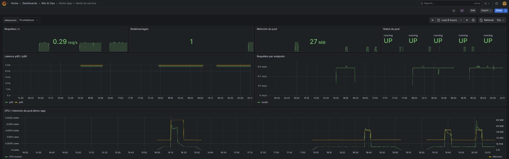
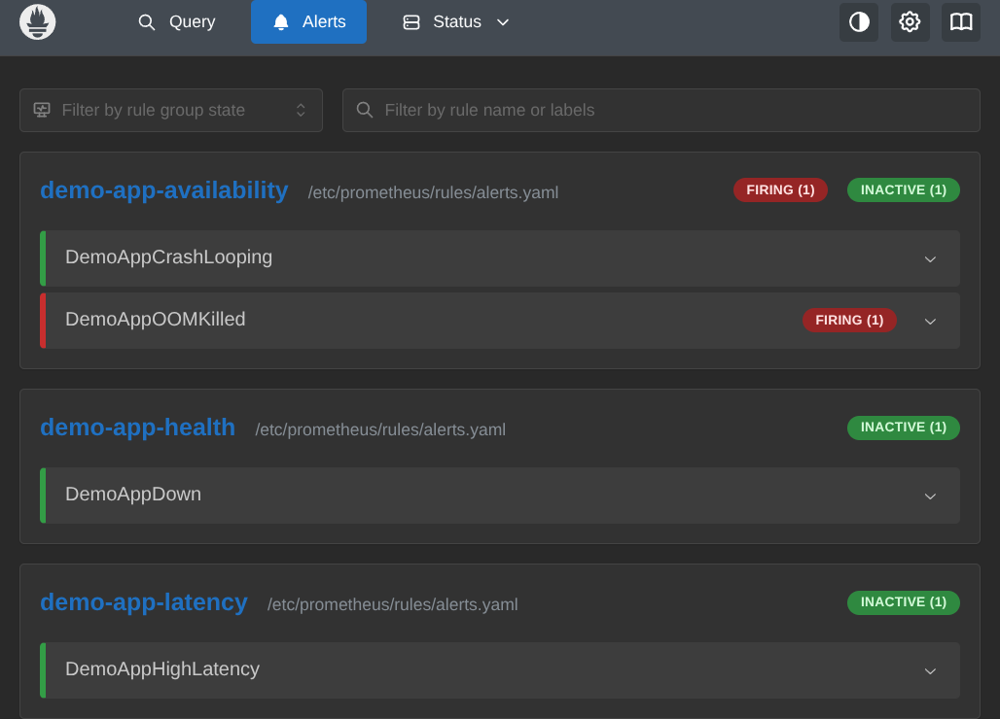
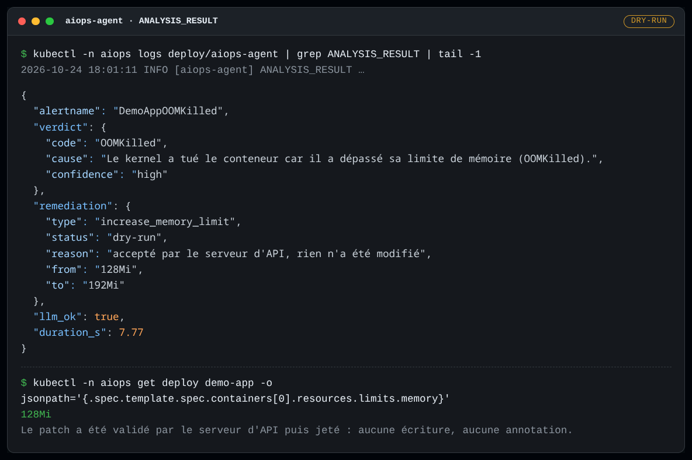
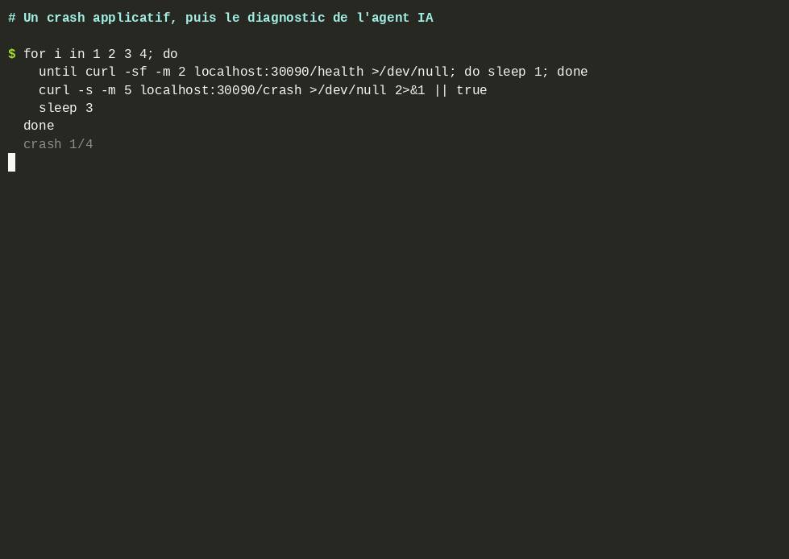
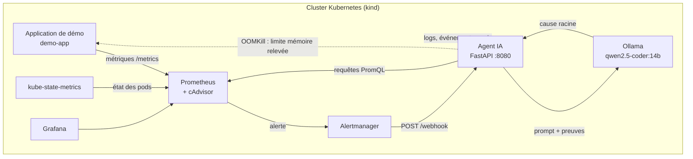
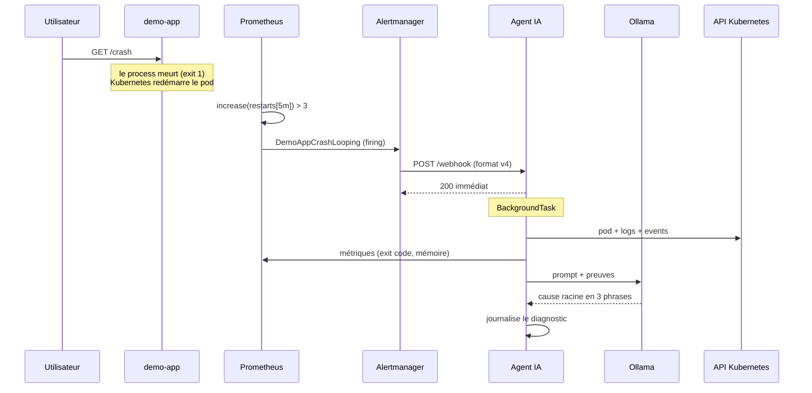
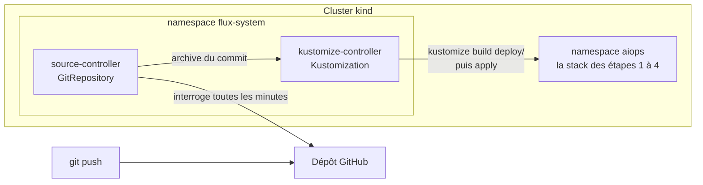
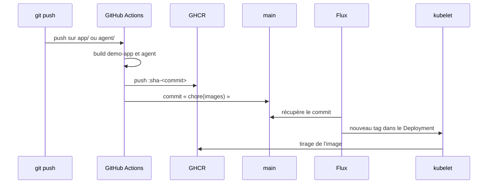

# K8s AI Ops Agent — Diagnostic et auto-guérison d'incidents Kubernetes avec un agent IA local

> **Projet en cours — étapes 1 à 6 terminées.**
> Construit comme projet d'apprentissage pour comprendre chaque brique de bout en bout.

[](https://github.com/Abi0066/k8s-aiops-agent/actions/workflows/agent-ci.yml)
[](https://github.com/Abi0066/k8s-aiops-agent/actions/workflows/infra-ci.yml)
[](https://github.com/Abi0066/k8s-aiops-agent/actions/workflows/images-release.yml)

**Sommaire** — [Aperçu](#aperçu) · [Le problème](#le-problème) ·
[Architecture](#architecture) · [Prérequis](#prérequis) ·
[Démarrage rapide](#démarrage-rapide) · [GitOps](#déploiement-gitops) ·
[CI/CD](#cicd-des-images) · [Configuration de l'agent](#configuration-de-lagent) ·
[Tests](#tests-et-vérifications) · [Structure](#structure-du-dépôt) ·
[Étapes](#étapes-du-projet) · [Choix techniques](#choix-techniques-et-justification) ·
[Dépannage](#dépannage) · [Limites](#limites-connues) · [Licence](#licence).

## Le problème

Quand une application Kubernetes plante, la chaîne de diagnostic est aujourd'hui
manuelle : on regarde `kubectl describe pod`, on fouille les logs, on croise avec
Grafana, on conjecture. Sur un incident réel en production, ce travail prend
des minutes — et l'astreinte nocturne, c'est une charge mentale supplémentaire.

Ce projet automatise la partie *diagnostic* : un agent IA local reçoit les
alertes, collecte les preuves (logs, événements, métriques, état du pod) et
propose une cause racine. Depuis l'étape 4, il corrige aussi lui-même
l'incident qu'il sait trancher avec certitude (un conteneur tué pour
dépassement de mémoire) — en mode `dry-run` par défaut, jamais en écriture
directe sans décision humaine.

## Aperçu

**Le tableau de bord** agrège les signaux que l'agent collecte : requêtes,
redémarrages, mémoire, statut des pods, latence, CPU. Les pics de mémoire
correspondent aux OOMKill provoqués par la démo.



**La détection** — Prometheus charge les trois groupes de règles. Un seul
OOMKill suffit à faire passer `DemoAppOOMKilled` en `FIRING`, sans attendre une
boucle de redémarrages.



**Le diagnostic** — l'agent croise les preuves, tranche `OOMKilled` avec une
confiance `high`, et prépare un patch `128Mi → 192Mi`. En `dry-run`, le serveur
d'API valide le patch sans l'enregistrer : la limite reste `128Mi` et aucune
annotation n'est écrite.



**La boucle complète** — quatre crashes, l'état du pod, l'attente de l'alerte,
puis le verdict de l'agent. L'enregistrement est accéléré : la pause visible
correspond au `for: 1m` de la règle et à l'inférence du LLM local.



## Architecture



Le chemin d'un incident, de bout en bout :



> L'agent répond `200` **avant** d'avoir analysé quoi que ce soit. Alertmanager
> a un timeout de 10 s ; sans cette réponse immédiate, il couperait la
> connexion et réessaierait en boucle. Le traitement se fait dans une
> `BackgroundTask` FastAPI.

## Prérequis

| Besoin | Version | Pourquoi |
|---|---|---|
| Podman **ou** Docker | Podman 3.0+ / Docker 20.10+ | Runtime de conteneurs pour `kind` |
| `br_netfilter` | noyau | Fait passer le trafic des pods dans iptables. Sans lui, le réseau interne K8s est cassé |
| Instances inotify | noyau, 512 au moins | containerd en ouvre une par conteneur pour être prévenu des OOMKill. À la valeur par défaut (128), la session peut les avoir déjà consommées : containerd n'arrive plus à s'abonner, un pod tué par manque de mémoire apparaît `Error` au lieu de `OOMKilled`, et l'auto-guérison ne se déclenche pas. La valeur courante se lit avec `cat /proc/sys/fs/inotify/max_user_instances` |
| `make` | — | Point d'entrée des scripts |
| Python | 3.12 | Facultatif : tests et lint en local (`make test lint`) |
| RAM libre | ~12 Go | Ollama charge un modèle de 14 milliards de paramètres |
| Espace disque | ~15 Go | images, archives de chargement et modèle Ollama |
| Accès réseau | `ghcr.io` (et `github.com` pour GitOps) | le kubelet tire les images du registre ; sans réseau, `make build` devient nécessaire |

Sur Fedora :

```bash
sudo modprobe br_netfilter
echo br_netfilter | sudo tee /etc/modules-load.d/k8s.conf
sudo sysctl -w fs.inotify.max_user_instances=512
echo fs.inotify.max_user_instances=512 | sudo tee /etc/sysctl.d/99-kind.conf
systemctl --user enable --now podman.socket
```

## Démarrage rapide

```bash
make setup        # installe kind + kubectl dans ~/.local/bin (sans root)
make cluster-up   # crée le cluster et déploie la stack (images tirées de GHCR)
make demo-crash   # provoque un incident et affiche le diagnostic
```

`make gitops-up` remplace `make cluster-up` pour un déploiement piloté par
Git : voir [Déploiement GitOps](#déploiement-gitops).

> **Premier démarrage :** Ollama télécharge le modèle `qwen2.5-coder:14b`
> (~9 Go) avant d'être prêt. Comptez plusieurs minutes selon la connexion ;
> pour suivre le téléchargement :
> `kubectl -n aiops logs deploy/ollama -c pull-model -f`.
>
> **Après une modification du code**, un `git push` sur `main` suffit : GitHub
> Actions construit et publie les images, puis Flux déploie le nouveau tag.
> Pour travailler hors ligne, `make build` construit le tag du manifest et le
> charge dans le nœud.

Puis ouvrez :

| Service | URL | Identifiants |
|---|---|---|
| Application | <http://localhost:30090/health> | — |
| Prometheus | <http://localhost:30093> | — |
| Grafana | <http://localhost:30094> | `admin` / `admin` |
| Agent IA | <http://localhost:8080/docs> (après `port-forward`) | — |

L'agent n'est **pas** exposé sur l'hôte : c'est un service interne au cluster.
Pour voir sa documentation interactive (FastAPI la génère automatiquement) :

```bash
kubectl -n aiops port-forward svc/aiops-agent 8080:8080
# puis ouvrir http://localhost:8080/docs
```

## Déploiement GitOps

`make cluster-up` applique les manifests **du disque** : pratique pour
développer, mais ce qui tourne dépend de qui a lancé quoi, depuis quelle
copie du dépôt. En GitOps, le cluster applique lui-même **ce qui est dans
Git**. Un changement passe par un commit, se relit dans une pull request, et
s'annule par un `git revert`.

```bash
make gitops-up    # installe Flux, qui déploie la stack depuis la branche main
make gitops-status
```



Les deux objets qui décrivent la synchronisation sont dans
[`deploy/flux-sync.yaml`](deploy/flux-sync.yaml) :

| Objet | Rôle | Réglage clé |
|---|---|---|
| `GitRepository` | quoi surveiller : un dépôt, une branche | `interval: 1m` : un push est déployé en une minute au plus |
| `Kustomization` | quoi appliquer : le dossier `deploy/` | `prune: true`, `wait: true`, `interval: 5m` |

Ce que ces réglages apportent :

- **une seule source de vérité.** `deploy/kustomization.yaml` assemble
  `manifests/` et `monitoring/`. `make cluster-up` (`kubectl apply -k deploy`)
  et Flux appliquent exactement le même rendu ;
- **la correction de dérive.** Toutes les 5 minutes, Flux réapplique Git même
  sans nouveau commit. Un `kubectl scale` ou un `kubectl edit` fait à la main
  est annulé : pour changer le cluster, on change Git ;
- **le nettoyage (`prune`).** Un objet retiré de Git est supprimé du cluster.
  Avec un simple `kubectl apply`, il resterait orphelin ;
- **un état vérifiable.** `make gitops-status` affiche le commit appliqué
  (`Applied revision: main@sha1:…`) ; la Kustomization n'est `Ready` que
  lorsque tous les objets le sont (`wait: true`), pas seulement acceptés par
  l'API.

Les deux comportements qui distinguent GitOps d'un `kubectl apply` ont été
mesurés sur le cluster, pas seulement lus dans la configuration :

| Test | Commande | Résultat observé |
|---|---|---|
| Correction de dérive | `kubectl -n aiops scale deploy/demo-app --replicas=3` | retour à 1 réplica en **311 s**, sans autre action |
| `prune` | ConfigMap ajouté puis retiré de Git | créé par Flux, puis supprimé (`NotFound`) |

La dérive n'est pas corrigée instantanément : elle attend le prochain cycle de
la Kustomization (`interval: 5m`). C'est le prix de l'intervalle — un
`make gitops-sync` force la réconciliation quand l'attente gêne.

Pour forcer une synchronisation sans attendre l'intervalle :

```bash
git push
make gitops-sync   # récupère le dernier commit et l'applique
```

Pour suivre un fork, ou une branche en cours de revue :

```bash
make gitops-up GITOPS_REPO_URL=https://github.com/<vous>/k8s-aiops-agent GITOPS_BRANCH=ma-branche
```

`flux-sync.yaml` n'est volontairement **pas** synchronisé par Flux lui-même :
il remettrait l'URL du dépôt principal à chaque cycle, et un fork ne pourrait
plus se déployer depuis sa propre branche. Le script l'applique une fois,
avec l'URL et la branche demandées.

> **Fork :** les noms d'images (`ghcr.io/abi0066/…`) sont écrits en dur dans
> le workflow et dans les manifests. Un fork doit les remplacer par son propre
> espace de noms GHCR, sinon il déploiera les images de ce dépôt. Le reste
> (URL et branche) se règle avec `GITOPS_REPO_URL` et `GITOPS_BRANCH`.

> **Les images viennent de GHCR.** Le kubelet les tire du registre
> (`imagePullPolicy: IfNotPresent`) ; `make build` reste le repli hors ligne.
> Voir [CI/CD des images](#cicd-des-images).

## CI/CD des images

Jusqu'à l'étape 5, un `git push` changeait les manifests mais pas le code
exécuté : les images ne vivaient que sur la machine. L'étape 6 ferme la
boucle.



| Décision | Choix | Raison |
|---|---|---|
| Tag | `sha-<7>` immuable | un tag publié ne change jamais de contenu ; l'image est reliée à un commit |
| Mise à jour du manifest | commit automatique par la CI | Flux reste à deux contrôleurs, aucun jeton d'écriture dans le cluster |
| Visibilité | packages publics | le kubelet tire sans secret ; un package privé demanderait un `imagePullSecret` |
| Repli local | `make build` | construit le tag du manifest et le charge dans kind, pour travailler hors ligne |

Le workflow (`.github/workflows/images-release.yml`) se déclenche sur un push
vers `main` touchant `app/**`, `agent/**` ou le workflow lui-même.
`workflow_dispatch` permet de publier sans changement de code. Une pull
request ne publie rien : seuls les commits de `main` produisent des images.

Deux réglages du dépôt sont nécessaires, une seule fois :

- **Settings → Actions → General → Workflow permissions** : « Read and write
  permissions ». Sans cela, le job de bump ne peut pas pousser son commit.
- **Visibilité des packages** : publics, pour que le kubelet tire sans
  `imagePullSecret`.

Vérifié de bout en bout : le commit `642e773` a produit l'image
`sha-642e773` (digest `sha256:d8bfa2…`), le commit de bump `0976317`, et le
pod alors en service (`demo-app-6f84…`) répondait avec cette image. Le build
précédent (`sha-c6591b9`) avait un autre digest : deux commits, deux images
distinctes.

Trois pièges rencontrés, et ce qu'ils apprennent :

- **Un push fait avec `GITHUB_TOKEN` ne déclenche aucun autre workflow.**
  C'est ce qui empêche le commit de bump de relancer la CI en boucle.
- **Modifier un fichier de `.github/workflows/` exige le scope `workflow`**
  sur le jeton Git, même avec `repo` : GitHub protège l'ajout de workflows.
- **GHCR répond `401` à un `curl` brut, même pour une image publique.** Le
  protocole Docker Registry v2 demande d'abord un jeton anonyme ; le vrai
  test est `podman pull` sans être connecté.

## Configuration de l'agent

Tout se règle par variables d'environnement dans
[`manifests/aiops-agent.yaml`](manifests/aiops-agent.yaml). Le tableau donne
la valeur par défaut du code ; le manifest ne s'en écarte que pour
`AUTOHEAL_MEMORY_MAX`.

| Variable | Défaut | Rôle |
|---|---|---|
| `OLLAMA_URL` | `http://ollama.aiops.svc.cluster.local:11434` | API du modèle |
| `PROMETHEUS_URL` | `http://prometheus.aiops.svc.cluster.local:9090` | source des métriques |
| `OLLAMA_MODEL` | `qwen2.5-coder:14b` | modèle utilisé (défini aussi dans la ConfigMap `ollama-config`) |
| `WATCHED_NAMESPACE` | `aiops` | namespace analysé quand l'alerte n'en porte pas |
| `LLM_TIMEOUT` | `300` s | délai maximal d'une inférence |
| `DEDUP_WINDOW_S` | `600` s | fenêtre anti-doublon |
| `LOG_LEVEL` | `INFO` | verbosité des logs |
| `AUTOHEAL_ENABLED` | `false` | active l'action corrective |
| `AUTOHEAL_DRY_RUN` | `true` | `dryRun=All` : le patch est validé sans être écrit |
| `AUTOHEAL_MEMORY_FACTOR` | `1.5` | nouvelle limite = ancienne × facteur |
| `AUTOHEAL_MEMORY_MAX` | `1Gi` (manifest : `512Mi`) | plafond de la limite |
| `AUTOHEAL_COOLDOWN_S` | `3600` s | une action par Deployment et par fenêtre |

Une valeur invalide (`AUTOHEAL_MEMORY_FACTOR=1`, `AUTOHEAL_MEMORY_MAX=abc`)
fait **échouer le démarrage** du pod : l'erreur apparaît tout de suite, pas au
premier incident. Les booléens sont stricts : seuls `1`, `true`, `yes` et
`on` activent `AUTOHEAL_ENABLED` ; une faute de frappe comme `oui` laisse le
système inactif, et toute valeur non reconnue pour `AUTOHEAL_DRY_RUN` laisse
le dry-run.

L'application de démonstration n'a qu'un réglage : `OOM_ALLOC_MB` (120 Mio),
la quantité allouée par `/oom`. Avec la limite de `128Mi`, elle provoque
l'OOMKill ; avec les `192Mi` d'après auto-guérison, la même requête passe.

## Tests et vérifications

Les tests unitaires et `make validate` ne demandent aucun cluster.

```bash
pip install -r agent/requirements.txt -r agent/requirements-dev.txt
make lint test    # ruff (agent + application) et pytest
make validate     # toute l'infrastructure, voir ci-dessous
```

Les tests de l'agent remplacent Kubernetes, Prometheus et Ollama par de faux
clients. Ils figent en particulier les verdicts de `diagnosis.py` pour chaque
combinaison `reason` / `exitCode`, l'échappement des requêtes PromQL,
l'anti-doublon du webhook et chaque garde-fou de l'auto-guérison (un faux
client enregistre les patchs que l'agent aurait envoyés).

`make validate` (`scripts/validate.sh`) n'a besoin que de Podman ou Docker :
chaque outil tourne dans un conteneur, à une version épinglée.

| Outil | Vérifie |
|---|---|
| shellcheck | les scripts shell |
| hadolint | les Dockerfiles |
| promtool | la configuration Prometheus, les règles d'alerte et leurs tests unitaires (`monitoring/prometheus/tests/`) |
| amtool | la configuration Alertmanager |
| kustomize + kubeconform | le rendu de `deploy/` (ce qu'appliquent kubectl et Flux) contre le schéma de l'API Kubernetes (champs inconnus, clés en double), et les objets Flux contre leur CRD |
| terraform | le formatage et la validité des modules |
| actionlint | les workflows GitHub Actions |

Les mêmes vérifications tournent dans GitHub Actions à chaque push et pull
request : `agent-ci` (lint + tests), `infra-ci` (`make validate` + construction
des deux images) et `images-release` (publication GHCR + commit de bump, sur
`main` uniquement).

## Structure du dépôt

```
├── app/                  Application de démonstration (la cible des incidents)
│   ├── main.py           /health, /crash, /oom, /metrics
│   └── Dockerfile
├── agent/                L'agent IA (étape 3)
│   ├── app/
│   │   ├── main.py       Service FastAPI : POST /webhook, GET /health
│   │   ├── models.py     Modèles Pydantic du payload Alertmanager (v4)
│   │   ├── collector.py  Collecte des preuves (API K8s + Prometheus)
│   │   ├── diagnosis.py  Verdict déterministe (le code décide, le LLM explique)
│   │   ├── remediation.py  Auto-guérison et ses garde-fous (étape 4)
│   │   └── llm.py        Prompt de diagnostic + appel à Ollama
│   ├── tests/            Tests unitaires pytest (sans cluster)
│   ├── pyproject.toml    Configuration de pytest et ruff
│   ├── requirements.txt
│   ├── requirements-dev.txt  pytest + ruff
│   └── Dockerfile
├── deploy/               Point d'entrée du déploiement (étape 5)
│   ├── kustomization.yaml  Assemble manifests/ et monitoring/
│   └── flux-sync.yaml    Ce que Flux surveille (dépôt, branche) et applique
├── docs/screenshots/     Captures utilisées par ce README
├── manifests/            Manifests Kubernetes
│   ├── kustomization.yaml  Liste des manifests déployés
│   ├── namespace.yaml    Le namespace aiops
│   ├── demo-app.yaml     L'application de démonstration
│   ├── aiops-agent.yaml  ServiceAccount + RBAC + Deployment + Service
│   └── ollama.yaml       ConfigMap (nom du modèle) + PVC + Deployment + Service
├── monitoring/
│   ├── prometheus/       Config, règles d'alerte (format natif) et leurs tests
│   ├── alertmanager/     Config Alertmanager (route, receivers, inhibitions)
│   ├── grafana/          Provisioning Grafana + dashboard
│   ├── kube-state-metrics.yaml
│   └── kustomization.yaml  Manifests + ConfigMaps générées depuis les configs
├── scripts/              Installation, pilotage et vérification (lib.sh : réglages communs)
├── terraform/            VPC AWS, socle réseau d'un futur EKS (jamais appliqué par défaut)
├── .github/workflows/    CI : agent-ci (lint + tests), infra-ci (validate + images),
│                         images-release (publication GHCR + commit de bump)
├── CHANGELOG.md          Historique des changements notables
├── LICENSE               Licence MIT
├── kind-config.yaml      Configuration du cluster local
└── Makefile              Point d'entrée unique
```

## Étapes du projet

| Étape | Contenu | État |
|---|---|---|
| 1 | Fondation : cluster kind, app de démo, Prometheus, Grafana | ✅ |
| 2 | Détection : règles d'alerte + webhook | ✅ |
| 3 | Agent IA : service FastAPI, collecte de preuves, LLM local | ✅ |
| 4 | Action : auto-guérison avec mode dry-run par défaut | ✅ |
| 5 | GitOps : Flux synchronise le cluster depuis Git, CI GitHub Actions | ✅ |
| 6 | CI/CD des images : build dans GitHub Actions, publication dans GHCR, déploiement du tag par Flux | ✅ |

## Choix techniques et justification

### `kind` plutôt qu'EKS pour commencer

Un cluster EKS coûte ~15 €/mois s'il reste allumé, demande ~20 minutes de
provisioning, et masque une grande partie des mécanismes internes derrière un
service managé. `kind` fait tourner un nœud Kubernetes complet dans un
conteneur : l'API est **la même** qu'en AWS, donc le code de l'agent est
identique dans les deux environnements. Le dossier `terraform/` pose le socle
réseau d'un futur cluster EKS (un VPC multi-AZ) pour montrer la voie de
production ; il n'est jamais appliqué par défaut.

### Prometheus « vanilla » plutôt que Prometheus Operator

Le Prometheus Operator expose les règles via des CRD `PrometheusRule`, ce qui
ajoute une dépendance et un mécanisme d'extension. Le Prometheus standard sait
déjà lire des groupes de règles au format `groups:` dans un simple fichier
YAML — c'est ce format qu'on utilise ici. Aucun CRD, aucune dépendance, et
chaque règle est lisible dans Git.

### `kube-state-metrics` est indispensable

Le kubelet expose l'activité (CPU, mémoire, trafic) mais pas l'historique
métier des objets. `kube-state-metrics` publie l'état des objets sous forme de
métriques : nombre de redémarrages, raison du dernier arrêt, phase du pod.
Sans lui, on ne peut pas distinguer un `CrashLoopBackOff` d'un `OOMKilled` en
lisant les métriques — ce qui est précisément la distinction que l'agent devra
faire.

### `waitress` et non `gunicorn` : un choix de scénario

Contre-intuitif, et c'est le point le plus pédagogique de l'étape 1.

Dans un conteneur, le **PID 1** est le process que le kubelet surveille : quand
il meurt, le conteneur s'arrête et Kubernetes le redémarre.

`gunicorn` est un **superviseur** : le PID 1 est le master, et les workers sont
des enfants. L'endpoint `/crash` appelle `os._exit(1)` pour simuler un crash
applicatif — mais avec gunicorn, cela ne tuerait que le worker ayant servi la
requête. Le master constaterait sa mort et en démarrerait un autre. Le conteneur
ne mourrait jamais, le pod ne redémarrerait pas, et **l'incident serait
totalement invisible**. C'est exactement ce qui a été observé pendant le
développement de ce projet.

`waitress` est **mono-processus** : le process Python *est* le PID 1. Le
`os._exit(1)` tue donc directement le PID 1, et le conteneur sort en code 1 :

```
Last State:  Terminated
  Reason:    Error
  Exit Code: 1
```

Un détail qui a coûté du temps : `os.kill(1, signal.SIGKILL)` **ne marche
pas**. Le noyau Linux ignore les signaux sans handler envoyés au PID 1 d'un
namespace, et SIGKILL ne peut pas être intercepté — le signal est
silencieusement perdu. Seuls SIGTERM (avec handler installé) et les appels
système d'arrêt fonctionnent.

Sur un vrai déploiement, on ferait l'inverse (plusieurs workers, pour qu'un
`bad request` ne tue pas le serveur). Ici on veut au contraire que la panne
soit visible au niveau du pod, puisque c'est le pod que l'agent doit
diagnostiquer.

### Le seuil de la règle d'alerte est calibré sur un vrai CrashLoopBackOff

La règle `DemoAppCrashLooping` s'appuie sur :

```
increase(kube_pod_container_status_restarts_total{...}[5m]) > 3
for: 1m
```

Autrement dit : **plus de 3 redémarrages en 5 minutes**, et la condition doit
rester vraie au moins 1 minute. Ce seuil n'est pas arbitraire — un seul
redémarrage est une illusion (un pod peut redémarrer une fois après un
déploiement, ou après une éviction de node). Ce qui caractérise un incident,
c'est la **répétition**.

Conséquence concrète sur la démo : `make demo-crash` déclenche **5 crashes**,
pas un seul. Et surtout, il **attend que le pod redevienne `Ready` avant
chaque crash**. Ce détail n'est pas cosmétique : après un crash, le kubelet
applique un back-off exponentiel (10 s, puis 20 s, puis 40 s, puis 80 s…). Pendant
ce back-off, le conteneur n'écoute pas — une requête `/crash` échoue avec
`connection refused` **sans que le process ait jamais été tué**. Sans cette
attente, le compteur de redémarrages ne bouge pas et l'alerte ne se déclenche
jamais, alors que le script affiche flegmatiquement « crash ok ».

Le double filtre (`> 3` redémarrages **et** `for: 1m`) est ce qui distingue une
alerte exploitable d'un faux positif : sans le `for`, une rafale brève ferait
sonner l'agent IA pour rien.

### Ollama tourne dans le cluster, pas sur la machine hôte

Ollama installé sur la machine hôte n'écoute que sur `127.0.0.1` — c'est son
comportement par défaut, et il est **raisonnable** : un serveur de modèles
n'a aucune raison d'être joignable depuis le réseau.

Mais l'agent est un pod : il ne peut joindre que ce qui est joignable depuis
le réseau du cluster. Les options étaient :

| Option | Pour | Contre |
|---|---|---|
| **Ollama dans le cluster** (retenu) | tout est dans Git, tout tourne dans kind, zéro configuration réseau côté hôte | ~9 Go de téléchargement, ~10 Go de RAM |
| Ollama sur l'hôte, sur `0.0.0.0` | le modèle est déjà en cache | il faut modifier le service systemd, et l'API du modèle devient joignable par le réseau local |
| `kubectl port-forward` | rien à installer | fragile : l'agent perd sa connectivité dès que le forward tombe |

Le modèle (~9 Go pour `qwen2.5-coder:14b`) est stocké dans un **PersistentVolumeClaim**, et téléchargé
par un `initContainer`. Deux raisons :

- **le PVC** évite de re-télécharger ~9 Go à chaque recréation de pod ;
  si le modèle y est déjà, l'initContainer ne contacte même pas le registre ;
- **l'initContainer** garantit que le pod n'est pas `Ready` tant que le
  modèle n'est pas là. L'agent ne doit pas recevoir de webhook alors que le
  modèle manque.

Le nom du modèle n'est écrit qu'à un endroit, la ConfigMap `ollama-config` :
l'initContainer qui le télécharge et l'agent qui l'interroge la lisent tous
les deux. Changer de modèle, c'est changer une ligne.

> **Un piège rencontré pendant le développement :** `ollama pull` est un
> **client**, pas le serveur. L'initContainer échouait avec
> `could not connect to ollama server`. Il faut lancer `ollama serve` en
> arrière-plan dans le même conteneur, attendre qu'il réponde, *puis* tirer
> le modèle.

### La sonde de vivacité ne doit dépendre de rien d'externe

Le premier déploiement de l'agent redémarrait **toutes les 30 secondes**.
La cause : la sonde de vivacité (`livenessProbe`) testait `/health`, qui
vérifie les dépendances — dont Ollama. Ollama n'était pas encore prêt, donc
la sonde échouait, donc Kubernetes redémarrait le pod. Et le redémarrage
n'aurait rien réparé : Ollama était justement la chose qui manquait.

La correction est la séparation des deux sondes :

| Sonde | Teste | Effet si elle échoue |
|---|---|---|
| `/live` (vivacité) | le processus Python répond | le pod est redémarré |
| `/health` (disponibilité) | Ollama, Prometheus et l'API K8s répondent | le pod sort du Service, mais n'est pas redémarré |

**La règle à retenir : la vivacité dépend de ce que je contrôle, la
disponibilité dépend de ce que je consomme.** Redémarrer un composant ne
répare que les pannes qui lui sont propres.

### Le RBAC de l'agent est limité au namespace

Le ServiceAccount de l'agent a un `Role` (pas un `ClusterRole`) : ses droits
s'arrêtent au namespace `aiops`. Un agent de diagnostic n'a aucune raison de
lire le reste du cluster — et encore moins les Secrets.

Le détail qui fait tout : `pods/log` est une **sous-ressource**. Elle ne
fait pas partie de l'objet `Pod` et doit être demandée explicitement :

```yaml
resources: ["pods", "events", "pods/log"]
```

Un RBAC qui oublie `pods/log` donne une application qui démarre sans la
moindre erreur et qui n'arrive pas à lire un seul log — un diagnostic
aveugle, sans message d'erreur. C'est le piège classique du RBAC Kubernetes.

Depuis l'étape 4, l'agent a **un seul** droit d'écriture, celui dont
l'auto-guérison a besoin :

```yaml
- apiGroups: ["apps"]
  resources: ["deployments"]
  resourceNames: ["demo-app"]
  verbs: ["get", "patch"]
```

`patch` et pas `update` (qui réécrit l'objet entier), et seulement sur
`demo-app` : l'agent ne peut modifier ni Ollama, ni Prometheus, ni son propre
Deployment.

### Le code décide, le LLM explique

C'est la leçon la plus importante de l'étape 3, et elle vient d'un échec.

**Ce qu'il s'est passé.** L'agent a diagnostiqué un `OOMKilled` sur un
crash applicatif qui sortait avec le code 1. Les preuves envoyées au
modèle étaient pourtant *correctes* : `reason: Error`, `exitCode: 1`. Le
modèle n'a pas lu ces champs — il a recomposé une histoire plausible à
partir d'autres éléments du prompt : la **limite de mémoire** (128 Mi,
une constante de configuration) et la consigne « 137 = OOMKill ». Résultat :
un diagnostic confiant, fluide, et faux.

Le modèle n'a pas de problème de *connaissance* ici. Il a un problème de
**raisonnement** : on lui demandait de faire un travail qu'un `if` fait
exactement.

**La correction.** Un module déterministe (`agent/app/diagnosis.py`) tranche
la cause à partir des champs structurés, dans un ordre de confiance
décroissant :

| Preuve | Verdict |
|---|---|
| `reason: OOMKilled` | `OOMKilled` — le kernel a tué pour dépassement mémoire |
| `exitCode: 137` (128+9) | `SIGKILL` — signature mémoire, mais confirmation attendue |
| `reason: Error` ou `exitCode: 1` | `ApplicationError` — le process a quitté en erreur |
| `exitCode: 143` (128+15) | `GracefulStop` — arrêt demandé, pas une panne |
| `state.reason: CrashLoopBackOff` | `CrashLoopBackOff` — le comportement courant |

Le verdict et sa preuve sont ensuite joints **au début** du prompt, avec une
contrainte explicite de ne pas le contredire et de ne jamais déduire une
cause d'une limite de ressources. Le LLM est cantonné à ce qu'il fait
bien : rédiger en français, relier la cause à la preuve, proposer une
action.

**Le principe :** *faites décider par du code ce qui peut être décidé par
du code, et ne laissez au modèle que ce qui relève du langage.* C'est ce
qui rend le système fiable — la partie qui peut halluciner est cantonnée à
la partie dont l'erreur n'a pas de conséquence opérationnelle.

### L'auto-guérison : le code agit, le LLM raconte

L'étape 4 pousse le principe précédent jusqu'à l'action. Quand le verdict
déterministe est `OOMKilled` avec une confiance `high` (Kubernetes a écrit
lui-même `reason: OOMKilled`), l'agent relève la limite de mémoire du
conteneur dans le Deployment qui a créé le pod : 128Mi → 192Mi. Le
LLM n'est consulté qu'**après**, pour expliquer l'action déjà décidée.
Un `exitCode: 137` seul (confiance `medium`) ne déclenche rien : on ne
relève pas une limite pour un incident qui n'est peut-être pas un manque
de mémoire.

Le chemin complet : `GET /oom` → OOMKill → alerte `DemoAppOOMKilled` (un
seul OOMKill suffit) → webhook → verdict → patch → nouveau pod à 192Mi →
la même requête `/oom` répond 200.

| Garde-fou | Réglage | Pourquoi |
|---|---|---|
| Désactivée par défaut | `AUTOHEAL_ENABLED` (absent = `false`) | agir sur le cluster doit être demandé explicitement |
| Dry-run par défaut | `AUTOHEAL_DRY_RUN` (absent = `true`) | le patch part avec `dryRun=All` : le serveur d'API le valide (RBAC, schéma, admission) sans rien enregistrer |
| Plafond | `AUTOHEAL_MEMORY_MAX` (`512Mi` ici) | relever une limite ne soigne pas une fuite mémoire : la hausse s'arrête |
| Une action par Deployment et par fenêtre | `AUTOHEAL_COOLDOWN_S` (`3600`) | un second OOMKill juste après la correction signale une fuite, pas une limite trop basse |
| Le LLM ne décide rien | — | `remediation.py` ne lit que le verdict et l'état du cluster |
| Tout est tracé | clé `remediation` d'`ANALYSIS_RESULT` | chaque décision est journalisée, y compris « ne rien faire » et pourquoi |

Une valeur mal tapée reste du côté sûr : `AUTOHEAL_ENABLED=oui` n'active
rien, `AUTOHEAL_DRY_RUN=flase` laisse le dry-run. Un facteur `<= 1` ou un
plafond illisible fait échouer le démarrage de l'agent, pas le premier
incident.

Trois détails d'implémentation font la différence :

- **Un patch « strategic merge ».** Le serveur fusionne la liste
  `containers` par nom de conteneur. Un merge patch JSON classique
  *remplacerait* la liste : le Deployment perdrait son image et ses sondes.
- **Un verrou optimiste.** Le patch porte le `resourceVersion` lu juste
  avant : si le Deployment a changé entre-temps (déploiement en cours, autre
  analyse), le serveur répond 409 au lieu d'écraser la modification.
- **Le délai est écrit sur le Deployment.** Les annotations
  `aiops-agent/autoheal-at` et `aiops-agent/autoheal-memory` disent quand
  et quoi : elles survivent au redémarrage de l'agent et se lisent avec
  `kubectl describe`.

Le manifest active l'action **en dry-run** : l'agent journalise ce qu'il
aurait fait. Passer en mode réel est une décision humaine :

```bash
kubectl -n aiops set env deploy/aiops-agent AUTOHEAL_DRY_RUN=false
make demo-oom
kubectl -n aiops logs deploy/aiops-agent | grep ANALYSIS_RESULT | tail -1
kubectl -n aiops get deploy demo-app -o jsonpath='{.spec.template.spec.containers[0].resources.limits.memory}'
```

**Limite à connaître : la correction est un pansement.** Le prochain
`kubectl apply -f manifests/` (ou une synchronisation GitOps) remet 128Mi,
la valeur du dépôt. L'annotation `aiops-agent/autoheal-memory` est là pour
qu'un humain reporte la nouvelle valeur dans le dépôt, ou corrige la
consommation de l'application.

**Si rien ne se passe sur kind.** Le pod tué affiche `reason: Error`
(code 137) au lieu de `OOMKilled` : containerd n'a pas pu surveiller les
OOMKill, faute d'instances inotify (voir les prérequis). Son journal le dit :
`podman exec k8s-aiops-control-plane journalctl -u containerd | grep "oom events"`.
Le verdict n'est alors qu'un SIGKILL de confiance moyenne et l'agent, à
raison, ne touche à rien. Après avoir relevé la limite, recréer le pod
(`kubectl -n aiops rollout restart deploy/demo-app`) : la surveillance
s'installe au démarrage du conteneur.

### L'alerte peut ne pas porter de namespace

La règle `up{job="demo-app"} == 0` produisait une alerte **sans label
`namespace`** : Prometheus scrape l'application par le nom DNS de son
Service (une cible statique), et rien ne rattache cette cible à un namespace.
La première implémentation devinait `"default"`, ce qui analysait l'incident
au mauvais endroit — et se heurtait au RBAC (volontairement limité à `aiops`),
qui rejetait la lecture des événements avec un 403.

Deux correctifs, à deux niveaux :

- la cible de scrape porte désormais `namespace: aiops`. L'alerte en hérite,
  et le routage comme l'inhibition d'Alertmanager peuvent s'appuyer dessus ;
- l'agent ne devine plus : si une alerte arrive sans namespace, il prend
  **le namespace qu'il surveille**.

Le 403 a finalement révélé une bonne propriété du RBAC — les droits sont bien
cloisonnés.

### L'agent répond 200 avant d'analyser

Alertmanager a un timeout de 10 s sur ses notifications. Un modèle 14B sur
CPU peut mettre plusieurs minutes pour une inférence (l'agent l'attend jusqu'à
300 s, `LLM_TIMEOUT`). Si le handler attendait la réponse du LLM, Alertmanager
couperait la connexion, considérerait la livraison comme échouée, et
**réessaierait** — relançant l'analyse en boucle.

La réponse est donc immédiate, et le traitement part dans une
`BackgroundTask` FastAPI (exécutée après l'envoi de la réponse HTTP).

Reste un deuxième piège : Alertmanager renvoie **tout le groupe** d'alertes à
chaque changement (`group_interval: 1m`), puis toutes les 4 h tant qu'il est
actif (`repeat_interval`). Sans précaution, chaque renvoi relancerait une
inférence pour des alertes déjà analysées. L'agent retient donc chaque alerte
traitée — son empreinte et son heure de début — pendant `DEDUP_WINDOW_S`
(10 minutes) ; un renvoi dans cette fenêtre est compté dans `duplicates` au
lieu d'être réanalysé. L'heure de début distingue un vrai nouvel incident :
une alerte résolue qui se redéclenche est analysée à nouveau.

> **Limite connue, assumée :** la tâche de fond vit dans le processus du
> pod. Si le pod est redémarré pendant l'analyse, le travail est perdu. En
> production, il faudrait une file de travail (Redis, RabbitMQ) ou un `Job`
> Kubernetes par analyse. C'est le compromis assumé d'une démonstration
> mono-utilisateur.

### Alertmanager est indispensable

Prometheus ne sait pas appeler un webhook : il n'envoie ses alertes qu'à
Alertmanager (section `alerting.alertmanagers`). Le chemin standard est donc
**Prometheus → Alertmanager → agent IA**.

C'est un progrès, pas une contrainte : Alertmanager apporte le *grouping*
(plusieurs alertes similaires → une notification), l'*inhibition* (une alerte
grave masque les alertes du même pod), les *silences* et le routage par
sévérité. Sans lui, une panne réseau déclencherait une rafale d'appels HTTP
que l'agent devrait analyser un par un.

Le tout reste du YAML versionné, sans CRD et sans Prometheus Operator : la
décision « Prometheus vanilla » tient.

### Le repli local charge l'image par une archive

En temps normal, le kubelet tire les images de GHCR. `make build` sert au
développement hors ligne : il construit le tag écrit dans le manifest et le
charge dans le nœud. Ce chargement passe par une archive, parce que `kind`
supporte Podman pour `kind create cluster`, mais `kind load docker-image`
appelle `docker save` et `docker image inspect` en dur. Le message d'erreur est
trompeur — `image: "X" not present locally` — alors que l'image est bien
présente : `kind` n'interroge jamais Podman.

Les scripts utilisent donc `kind load image-archive` : `podman save` (ou
`docker save`) écrit l'image dans une archive, que `kind` importe dans le
containerd du nœud. Les deux runtimes suivent le même chemin, sans faux
exécutable `docker` à installer.

Deux détails qui comptent :

- **les noms et tags d'images ne sont écrits que dans les manifests.** Les
  scripts les y lisent (`scripts/lib.sh`) et c'est ce que réécrit le commit de
  bump : une seule source, lue par `make build` comme par Flux ;
- **une image déjà présente dans le nœud n'est pas rechargée** (l'archive
  d'Ollama pèse plusieurs Go). Seules nos deux images, reconstruites, sont
  rechargées à chaque `make build`.

> **Attention au tag.** Le tag `sha-<commit>` est immuable dans le registre.
> `make build` reconstruit ce même tag avec votre copie de travail : si elle
> contient des modifications non commitées, le nœud exécutera du code que le
> commit ne contient pas. Pour un essai local, c'est voulu ; pour un tag qui
> doit rester une preuve, reconstruisez depuis un arbre propre.

### Les conteneurs tournent sans privilèges

Les pods suivent le profil *restricted* des Pod Security Standards de
Kubernetes, et ajoutent un système de fichiers en lecture seule quand le
logiciel le permet :

| Réglage | Ce qu'il empêche |
|---|---|
| `runAsNonRoot` + un `runAsUser` non nul | l'exécution en root : le kubelet refuse de lancer un conteneur sous l'UID 0 |
| `readOnlyRootFilesystem` | la modification du code ou des binaires pendant que le conteneur tourne |
| `capabilities.drop: [ALL]`, `allowPrivilegeEscalation: false` | l'usage des capacités Linux, et leur récupération via un binaire setuid |
| `seccompProfile: RuntimeDefault` | les appels système rares et dangereux, filtrés par le runtime |

Chaque image garde son propre UID : 1000 pour nos deux images (le `USER` des
Dockerfiles), 65534 (`nobody`) pour Prometheus, Alertmanager et
kube-state-metrics, 472 pour Grafana.

Avec un système de fichiers en lecture seule, les répertoires où le logiciel
écrit sont des volumes `emptyDir`. Pour nos deux images, `/tmp` est sur
disque, pas en mémoire (`medium: Memory`) : un tmpfs compte dans la limite
mémoire du conteneur, et fausserait le scénario `/oom` de l'application de
démonstration, limitée à 128 Mi.

Deux exceptions, assumées :

- **Grafana** garde un système de fichiers inscriptible : il écrit ses logs
  et ses plugins dans l'image elle-même ;
- **Ollama** reste root, car les modèles déjà présents dans son volume lui
  appartiennent, et monte `/dev/dri` de l'hôte pour le GPU. Il garde seccomp,
  aucune capacité Linux et aucune élévation de privilèges.

### Flux plutôt qu'Argo CD

La feuille de route prévoyait Argo CD. Les deux outils font la même chose
(un contrôleur dans le cluster qui applique Git) ; la différence est le
poids, et ce cluster partage la machine avec un modèle de 14 milliards de
paramètres.

| | Flux (retenu) | Argo CD |
|---|---|---|
| Pods installés | 2 (source-controller, kustomize-controller) | 7 dans l'installation standard : API + UI, repo-server, contrôleur d'applications, Redis, Dex, ApplicationSet, notifications |
| Mémoire | 64 Mi demandés par contrôleur | quelques centaines de Mo en pratique |
| Interface | CLI et `kubectl` | interface web |

Flux est modulaire : `flux install --components=...` n'installe que les deux
contrôleurs utiles ici, sans les contrôleurs Helm, de notifications et
d'images. Sa CLI tourne dans un conteneur épinglé (`ghcr.io/fluxcd/flux-cli`),
comme les outils de `make validate` : rien à installer sur l'hôte. L'interface
web d'Argo CD est son vrai avantage — pour une démonstration en ligne de
commande, elle ne justifie pas son coût.

### Les ConfigMaps de configuration sont générées par kustomize

La configuration de Prometheus, ses règles d'alerte, celle d'Alertmanager et
les dashboards Grafana restent des fichiers lisibles et commentés
(`monitoring/`), vérifiés tels quels par promtool et amtool. Avant l'étape 5,
`cluster-up.sh` les emballait dans des ConfigMaps avec
`kubectl create configmap` : une étape impérative qu'un outil GitOps ne sait
pas rejouer. Le `configMapGenerator` de `monitoring/kustomization.yaml` fait
la même chose de façon déclarative, au moment du rendu.

Bonus : kustomize ajoute au nom de chaque ConfigMap une empreinte de son
contenu (`prometheus-config-9c4d68gm99`) et réécrit les Deployments qui la
montent. Modifier une règle d'alerte change le nom de la ConfigMap, donc le
Deployment, donc Kubernetes recrée le pod avec la nouvelle configuration.
Avec un nom fixe, le pod garderait l'ancienne configuration jusqu'à son
prochain redémarrage. L'ancienne ConfigMap, qui n'est plus dans le rendu,
est supprimée par Flux (`prune`).

### Les images viennent de GHCR

À l'étape 5, les images n'existaient que sur la machine : `make build` les
chargeait dans le nœud, et `imagePullPolicy: Never` empêchait le kubelet de
chercher ailleurs. L'étape 6 renverse la situation : les manifests portent un
nom de registre (`ghcr.io/abi0066/…`) et `imagePullPolicy: IfNotPresent`
laisse le kubelet tirer l'image publiée par la CI.

Le repli local reste possible : `make build` lit le tag dans le manifest,
construit la même référence et la charge dans kind. Le nœud la trouve sur
place et ne tire rien. C'est ce qui permet de travailler hors ligne.

### Un commit de bump plutôt que Flux Image Automation

Deux façons de mettre à jour l'image d'un Deployment depuis Git :

| | Commit de bump (retenu) | Flux Image Automation |
|---|---|---|
| Qui écrit dans Git | GitHub Actions | un contrôleur Flux |
| Contrôleurs Flux | 2 (inchangé) | 4 |
| Jeton d'écriture dans le cluster | aucun | oui (clé de déploiement) |
| Traçabilité | commit du bot, `git revert` | commit du bot, même principe |
| Latence | un run de CI | un scan du registre |

Le commit de bump ajoute une étape visible : la CI réécrit `manifests/*.yaml`
puis pousse. C'est moins « magique », mais le cluster n'a aucun droit
d'écriture sur le dépôt, et l'image déployée reste reliée à un commit.

## Dépannage

Vérifier une installation en cinq commandes :

```bash
make status          # nœud et pods Ready
curl -s http://localhost:30090/health
make agent-health    # /health de l'agent et ses dépendances (Ollama, Prometheus)
make last-analysis   # dernier diagnostic de l'agent, formaté
make gitops-status   # commit appliqué par Flux
```

| Symptôme | Cause probable | Action |
|---|---|---|
| `kubectl` : `connection refused` sur 8443 | le conteneur kind est arrêté (redémarrage de la machine) | `podman start k8s-aiops-control-plane`, puis attendre `Ready` |
| Pod en `ErrImagePull` / `ImagePullBackOff` | package GHCR privé, tag absent, ou pas de réseau | `podman pull <image>` **sans** être connecté ; rendre le package public ; `kubectl describe pod` |
| Pod en `ErrImageNeverPull` | manifest d'avant l'étape 6 (`imagePullPolicy: Never`) | `git pull`, puis `make gitops-sync` |
| Pod tué mais `reason: Error` au lieu de `OOMKilled` | containerd n'a pas pu surveiller les OOMKill (inotify) | relever `fs.inotify.max_user_instances`, puis `rollout restart` |
| `DemoAppCrashLooping` ne se déclenche pas | moins de 4 redémarrages en 5 min, ou `for: 1m` non écoulé | lire la colonne `RESTARTS`, attendre, relancer `make demo-crash` |
| Webhook reçu mais pas de nouvel `ANALYSIS_RESULT` | alerte déjà `firing` (Alertmanager ne la renvoie qu'après `repeat_interval`, 4 h) ou anti-doublon | recréer le pod pour repartir d'un état propre, ou attendre la fin de la fenêtre |
| L'agent répond mais `/health` renvoie 503 | Ollama ou Prometheus injoignable | `make agent-health`, puis les logs du pod concerné |
| Flux ne voit pas un commit | intervalle de 1 min, ou erreur de lecture du dépôt | `make gitops-status`, puis `kubectl -n flux-system describe gitrepository k8s-aiops-agent` |
| Une modification manuelle disparaît | correction de dérive de Flux (5 min) | comportement attendu : passer par Git |
| `localhost:30090` déjà utilisé | un autre processus écoute le port | `ss -ltnp` |

## Limites connues

Ce projet est une démonstration locale, pas une plateforme de production. Ce
qu'il ne couvre pas, et pourquoi :

| Limite | Conséquence | Piste |
|---|---|---|
| Les images ne sont ni signées ni scannées | la CI construit et publie sans SBOM, sans `trivy`, sans signature `cosign` | ajouter un scan bloquant et une signature avant publication |
| Une seule architecture | `linux/amd64` uniquement ; un Mac ARM ne pourrait pas exécuter l'image telle quelle | `platforms: linux/amd64,linux/arm64` dans buildx |
| Le bump est poussé directement sur `main` | le commit de la CI n'est pas relu | ouvrir une PR automatique si le dépôt exige une revue |
| Auto-guérison volontairement étroite | un seul cas (`OOMKilled`, confiance `high`), une seule action (relever la limite), plafond `512Mi`, une action par heure | ajouter une action seulement après avoir défini son dry-run et son retour arrière |
| Le correctif mémoire est écrasé par Git | l'annotation `aiops-agent/autoheal-memory` le signale ; le prochain `apply` remet `128Mi` | reporter la valeur dans le dépôt, ou corriger la consommation de l'application |
| Anti-doublon par alerte, pas par pod | `DemoAppCrashLooping` et `DemoAppDown` ont chacune leur empreinte : un même pod produit deux analyses LLM | dédupliquer par `namespace/pod` sur une fenêtre courte |
| Un seul nœud kind | pas de tolérance de panne, pas de scheduling multi-nœuds, pas de test de `PodDisruptionBudget` | EKS via `terraform/`, ou un cluster kind multi-nœuds |
| Stockage éphémère | Prometheus, Alertmanager et Grafana sont en `emptyDir` : métriques, silences et utilisateurs sont perdus au redémarrage du pod | PVC (celui d'Ollama montre le mécanisme) |
| Aucune authentification | Prometheus, Grafana (`admin`/`admin`) et l'agent sont exposés sans TLS sur des ports de nœud | Ingress + TLS + secrets, hors périmètre d'un cluster local |
| Terraform jamais appliqué | `terraform/` décrit un VPC multi-AZ pour un futur EKS, sans aucun `apply` | à traiter dans une étape 7 (EKS) si le coût AWS est accepté |

## Nettoyage

```bash
make cluster-down   # détruit le cluster, ses volumes et le réseau kind
make clean-images   # idem, et supprime aussi les deux images du projet
```

Le modèle d'Ollama vit dans un volume du cluster : il est supprimé avec lui,
et retéléchargé (~9 Go) au prochain `make cluster-up` ou `make gitops-up`.

Rien n'est facturé : le cluster est local, le Terraform n'est jamais appliqué
par défaut, et GitHub Actions comme GHCR sont gratuits pour un dépôt public.

## Licence

MIT — voir [`LICENSE`](LICENSE). Le texte couvre le code et les manifests du
dépôt ; les images de base et les composants tiers (kind, Prometheus, Grafana,
Ollama, Flux…) gardent leurs licences respectives.
