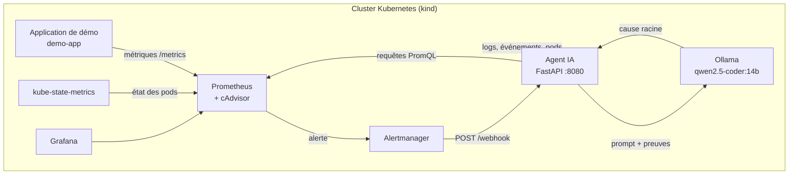
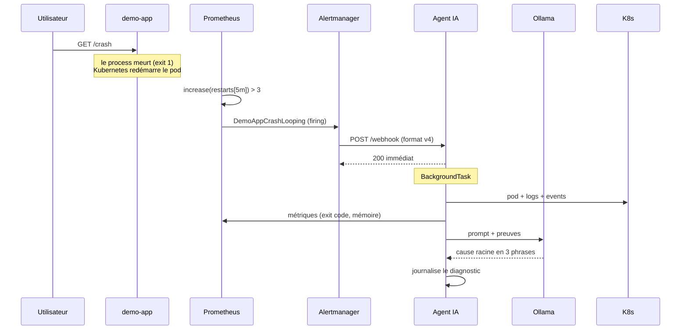

# K8s AI Ops Agent — Diagnostic et auto-guérison d'incidents Kubernetes avec un agent IA local

> **Projet en cours — étapes 1 à 3 terminées.**
> Construit comme projet d'apprentissage pour comprendre chaque brique de bout en bout.

## Le problème

Quand une application Kubernetes plante, la chaîne de diagnostic est aujourd'hui
manuelle : on regarde `kubectl describe pod`, on fouille les logs, on croise avec
Grafana, on conjecture. Sur un incident réel en production, ce travail prend
des minutes — et l'astreinte nocturne, c'est une charge mentale supplémentaire.

Ce projet automatise la partie *diagnostic* : un agent IA local reçoit les
alertes, collecte les preuves (logs, événements, métriques, état du pod) et
propose une cause racine. À l'étape 4, il pourra appliquer une correction
automatiquement — en mode `dry-run` par défaut, jamais en écriture directe.

## Architecture

<!-- Schéma Mermaid — détaillée à l'étape 5 -->



Le chemin d'un incident, de bout en bout :



> L'agent répond `200` **avant** d'avoir analysé quoi que ce soit. Alertmanager
> a un timeout de 10 s ; sans cette réponse immédiate, il couperait la
> connexion et réessaierait en boucle. Le traitement se fait dans une
> `BackgroundTask` FastAPI.

## Prérequis

| Besoin | Version | Pourquoi |
|---|---|---|
| Podman **ou** Docker | Podman 3.0+ / Docker 20.10+ | Runtime de conteneurs pour `kind` |
| `br_netfilter` | noyau | Fait passer le trafic des pods dans iptables. Sans lui, le réseau interne K8s est cassé |
| `make` | — | Point d'entrée des scripts |
| Python | 3.12 | Facultatif : tests et lint en local (`make test lint`) |
| RAM libre | ~12 Go | Ollama charge un modèle de 14 milliards de paramètres |

Sur Fedora :

```bash
sudo modprobe br_netfilter
echo br_netfilter | sudo tee /etc/modules-load.d/k8s.conf
systemctl --user enable --now podman.socket
```

## Démarrage rapide

```bash
make setup        # installe kind + kubectl dans ~/.local/bin (sans root)
make build        # construit les images de l'application et de l'agent
make cluster-up   # crée le cluster, y charge les images, déploie les étapes 1 à 3
make demo-crash   # provoque un incident et affiche le diagnostic
```

> **Premier démarrage :** Ollama télécharge le modèle `qwen2.5-coder:14b`
> (~9 Go) avant d'être prêt. Comptez plusieurs minutes selon la connexion ;
> pour suivre le téléchargement :
> `kubectl -n aiops logs deploy/ollama -c pull-model -f`.
>
> **Après une modification du code**, `make build` reconstruit les images,
> les recharge dans le cluster et redémarre les pods concernés.

Puis ouvrez :

| Service | URL | Identifiants |
|---|---|---|
| Application | <http://localhost:30090/health> | — |
| Prometheus | <http://localhost:30093> | — |
| Grafana | <http://localhost:30094> | `admin` / `admin` |
| Agent IA | <http://localhost:8080/docs> (après `port-forward`) | — |

L'agent n'est **pas** exposé sur l'hôte : c'est un service interne au cluster.
Pour voir sa documentation interactive (FastAPI la génère automatiquement) :

```bash
kubectl -n aiops port-forward svc/aiops-agent 8080:8080
# puis ouvrir http://localhost:8080/docs
```

## Tests et vérifications

Tout se vérifie **sans cluster**.

```bash
pip install -r agent/requirements.txt -r agent/requirements-dev.txt
make lint test    # ruff (agent + application) et pytest
make validate     # toute l'infrastructure, voir ci-dessous
```

Les tests de l'agent remplacent Kubernetes, Prometheus et Ollama par de faux
clients. Ils figent en particulier les verdicts de `diagnosis.py` pour chaque
combinaison `reason` / `exitCode`, l'échappement des requêtes PromQL et
l'anti-doublon du webhook.

`make validate` (`scripts/validate.sh`) n'a besoin que de Podman ou Docker :
chaque outil tourne dans un conteneur, à une version épinglée.

| Outil | Vérifie |
|---|---|
| shellcheck | les scripts shell |
| hadolint | les Dockerfiles |
| promtool | la configuration Prometheus, les règles d'alerte et leurs tests unitaires (`monitoring/prometheus/tests/`) |
| amtool | la configuration Alertmanager |
| kubeconform | les manifests, contre le schéma de l'API Kubernetes (champs inconnus, clés en double) |
| terraform | le formatage et la validité des modules |
| actionlint | les workflows GitHub Actions |

Les mêmes vérifications tournent dans GitHub Actions à chaque push et pull
request : `agent-ci` (lint + tests) et `infra-ci` (`make validate` + construction
des deux images).

## Structure du dépôt

```
├── app/                  Application de démonstration (la cible des incidents)
│   ├── main.py           /health, /crash, /oom, /metrics
│   └── Dockerfile
├── agent/                L'agent IA (étape 3)
│   ├── app/
│   │   ├── main.py       Service FastAPI : POST /webhook, GET /health
│   │   ├── models.py     Modèles Pydantic du payload Alertmanager (v4)
│   │   ├── collector.py  Collecte des preuves (API K8s + Prometheus)
│   │   ├── diagnosis.py  Verdict déterministe (le code décide, le LLM explique)
│   │   └── llm.py        Prompt de diagnostic + appel à Ollama
│   ├── tests/            Tests unitaires pytest (sans cluster)
│   ├── pyproject.toml    Configuration de pytest et ruff
│   ├── requirements.txt
│   ├── requirements-dev.txt  pytest + ruff
│   └── Dockerfile
├── manifests/            Manifests Kubernetes
│   ├── namespace.yaml    Le namespace aiops
│   ├── demo-app.yaml     L'application de démonstration
│   ├── aiops-agent.yaml  ServiceAccount + RBAC + Deployment + Service
│   └── ollama.yaml       ConfigMap (nom du modèle) + PVC + Deployment + Service
├── monitoring/
│   ├── prometheus/       Config, règles d'alerte (format natif) et leurs tests
│   ├── alertmanager/     Config Alertmanager (route, receivers, inhibitions)
│   ├── grafana/          Provisioning Grafana + dashboard
│   └── kube-state-metrics.yaml
├── scripts/              Installation, pilotage et vérification (lib.sh : réglages communs)
├── terraform/            VPC AWS, socle réseau d'un futur EKS (jamais appliqué par défaut)
├── .github/workflows/    CI : agent-ci (ruff + pytest), infra-ci (make validate + images)
├── kind-config.yaml      Configuration du cluster local
└── Makefile              Point d'entrée unique
```

## Étapes du projet

| Étape | Contenu | État |
|---|---|---|
| 1 | Fondation : cluster kind, app de démo, Prometheus, Grafana | ✅ |
| 2 | Détection : règles d'alerte + webhook | ✅ |
| 3 | Agent IA : service FastAPI, collecte de preuves, LLM local | ✅ |
| 4 | Action : auto-guérison avec mode dry-run par défaut | 🔜 |
| 5 | GitOps : CI/CD, ArgoCD, README final et démo | 🔜 |

## Choix techniques et justification

### `kind` plutôt qu'EKS pour commencer

Un cluster EKS coûte ~15 €/mois s'il reste allumé, demande ~20 minutes de
provisioning, et masque une grande partie des mécanismes internes derrière un
service managé. `kind` fait tourner un nœud Kubernetes complet dans un
conteneur : l'API est **la même** qu'en AWS, donc le code de l'agent est
identique dans les deux environnements. Le dossier `terraform/` pose le socle
réseau d'un futur cluster EKS (un VPC multi-AZ) pour montrer la voie de
production ; il n'est jamais appliqué par défaut.

### Prometheus « vanilla » plutôt que Prometheus Operator

Le Prometheus Operator expose les règles via des CRD `PrometheusRule`, ce qui
ajoute une dépendance et un mécanisme d'extension. Le Prometheus standard sait
déjà lire des groupes de règles au format `groups:` dans un simple fichier
YAML — c'est ce format qu'on utilise ici. Aucun CRD, aucune dépendance, et
chaque règle est lisible dans Git.

### `kube-state-metrics` est indispensable

Le kubelet expose l'activité (CPU, mémoire, trafic) mais pas l'historique
métier des objets. `kube-state-metrics` publie l'état des objets sous forme de
métriques : nombre de redémarrages, raison du dernier arrêt, phase du pod.
Sans lui, on ne peut pas distinguer un `CrashLoopBackOff` d'un `OOMKilled` en
lisant les métriques — ce qui est précisément la distinction que l'agent devra
faire.

### `imagePullPolicy: Never` sur l'application de démonstration

L'image n'existe que localement (chargée par `kind load`). Sans ce réglage, le
kubelet tente de la tirer depuis un registre distant et échoue en `ErrImagePull`.

### `waitress` et non `gunicorn` : un choix de scénario

Contre-intuitif, et c'est le point le plus pédagogique de l'étape 1.

Dans un conteneur, le **PID 1** est le process que le kubelet surveille : quand
il meurt, le conteneur s'arrête et Kubernetes le redémarre.

`gunicorn` est un **superviseur** : le PID 1 est le master, et les workers sont
des enfants. L'endpoint `/crash` appelle `os._exit(1)` pour simuler un crash
applicatif — mais avec gunicorn, cela ne tuerait que le worker ayant servi la
requête. Le master constaterait sa mort et en démarrerait un autre. Le conteneur
ne mourrait jamais, le pod ne redémarrerait pas, et **l'incident serait
totalement invisible**. C'est exactement ce qui a été observé pendant le
développement de ce projet.

`waitress` est **mono-processus** : le process Python *est* le PID 1. Le
`os._exit(1)` tue donc directement le PID 1, et le conteneur sort en code 1 :

```
Last State:  Terminated
  Reason:    Error
  Exit Code: 1
```

Un détail qui a coûté du temps : `os.kill(1, signal.SIGKILL)` **ne marche
pas**. Le noyau Linux ignore les signaux sans handler envoyés au PID 1 d'un
namespace, et SIGKILL ne peut pas être intercepté — le signal est
silencieusement perdu. Seuls SIGTERM (avec handler installé) et les appels
système d'arrêt fonctionnent.

Sur un vrai déploiement, on ferait l'inverse (plusieurs workers, pour qu'un
`bad request` ne tue pas le serveur). Ici on veut au contraire que la panne
soit visible au niveau du pod, puisque c'est le pod que l'agent doit
diagnostiquer.

### Le seuil de la règle d'alerte est calibré sur un vrai CrashLoopBackOff

La règle `DemoAppCrashLooping` s'appuie sur :

```
increase(kube_pod_container_status_restarts_total{...}[5m]) > 3
for: 1m
```

Autrement dit : **plus de 3 redémarrages en 5 minutes**, et la condition doit
rester vraie au moins 1 minute. Ce seuil n'est pas arbitraire — un seul
redémarrage est une illusion (un pod peut redémarrer une fois après un
déploiement, ou après une éviction de node). Ce qui caractérise un incident,
c'est la **répétition**.

Conséquence concrète sur la démo : `make demo-crash` déclenche **5 crashes**,
pas un seul. Et surtout, il **attend que le pod redevienne `Ready` avant
chaque crash**. Ce détail n'est pas cosmétique : après un crash, le kubelet
applique un back-off exponentiel (10 s, puis 20 s, puis 40 s, puis 80 s…). Pendant
ce back-off, le conteneur n'écoute pas — une requête `/crash` échoue avec
`connection refused` **sans que le process ait jamais été tué**. Sans cette
attente, le compteur de redémarrages ne bouge pas et l'alerte ne se déclenche
jamais, alors que le script affiche flegmatiquement « crash ok ».

Le double filtre (`> 3` redémarrages **et** `for: 1m`) est ce qui distingue une
alerte exploitable d'un faux positif : sans le `for`, une rafale brève ferait
sonner l'agent IA pour rien.

### Ollama tourne dans le cluster, pas sur la machine hôte

Ollama installé sur la machine hôte n'écoute que sur `127.0.0.1` — c'est son
comportement par défaut, et il est **raisonnable** : un serveur de modèles
n'a aucune raison d'être joignable depuis le réseau.

Mais l'agent est un pod : il ne peut joindre que ce qui est joignable depuis
le réseau du cluster. Les options étaient :

| Option | Pour | Contre |
|---|---|---|
| **Ollama dans le cluster** (retenu) | tout est dans Git, tout tourne dans kind, zéro configuration réseau côté hôte | ~9 Go de téléchargement, ~10 Go de RAM |
| Ollama sur l'hôte, sur `0.0.0.0` | le modèle est déjà en cache | il faut modifier le service systemd, et l'API du modèle devient joignable par le réseau local |
| `kubectl port-forward` | rien à installer | fragile : l'agent perd sa connectivité dès que le forward tombe |

Le modèle (~9 Go pour `qwen2.5-coder:14b`) est stocké dans un **PersistentVolumeClaim**, et téléchargé
par un `initContainer`. Deux raisons :

- **le PVC** évite de re-télécharger ~9 Go à chaque recréation de pod ;
  si le modèle y est déjà, l'initContainer ne contacte même pas le registre ;
- **l'initContainer** garantit que le pod n'est pas `Ready` tant que le
  modèle n'est pas là. L'agent ne doit pas recevoir de webhook alors que le
  modèle manque.

Le nom du modèle n'est écrit qu'à un endroit, la ConfigMap `ollama-config` :
l'initContainer qui le télécharge et l'agent qui l'interroge la lisent tous
les deux. Changer de modèle, c'est changer une ligne.

> **Un piège rencontré pendant le développement :** `ollama pull` est un
> **client**, pas le serveur. L'initContainer échouait avec
> `could not connect to ollama server`. Il faut lancer `ollama serve` en
> arrière-plan dans le même conteneur, attendre qu'il réponde, *puis* tirer
> le modèle.

### La sonde de vivacité ne doit dépendre de rien d'externe

Le premier déploiement de l'agent redémarrait **toutes les 30 secondes**.
La cause : la sonde de vivacité (`livenessProbe`) testait `/health`, qui
vérifie les dépendances — dont Ollama. Ollama n'était pas encore prêt, donc
la sonde échouait, donc Kubernetes redémarrait le pod. Et le redémarrage
n'aurait rien réparé : Ollama était justement la chose qui manquait.

La correction est la séparation des deux sondes :

| Sonde | Teste | Effet si elle échoue |
|---|---|---|
| `/live` (vivacité) | le processus Python répond | le pod est redémarré |
| `/health` (disponibilité) | Ollama, Prometheus et l'API K8s répondent | le pod sort du Service, mais n'est pas redémarré |

**La règle à retenir : la vivacité dépend de ce que je contrôle, la
disponibilité dépend de ce que je consomme.** Redémarrer un composant ne
répare que les pannes qui lui sont propres.

### Le RBAC de l'agent est limité au namespace

Le ServiceAccount de l'agent a un `Role` (pas un `ClusterRole`) : ses droits
s'arrêtent au namespace `aiops`. Un agent de diagnostic n'a aucune raison de
lire le reste du cluster — et encore moins les Secrets.

Le détail qui fait tout : `pods/log` est une **sous-ressource**. Elle ne
fait pas partie de l'objet `Pod` et doit être demandée explicitement :

```yaml
resources: ["pods", "events", "pods/log"]
```

Un RBAC qui oublie `pods/log` donne une application qui démarre sans la
moindre erreur et qui n'arrive pas à lire un seul log — un diagnostic
aveugle, sans message d'erreur. C'est le piège classique du RBAC Kubernetes.

### Le code décide, le LLM explique

C'est la leçon la plus importante de l'étape 3, et elle vient d'un échec.

**Ce qu'il s'est passé.** L'agent a diagnostiqué un `OOMKilled` sur un
crash applicatif qui sortait avec le code 1. Les preuves envoyées au
modèle étaient pourtant *correctes* : `reason: Error`, `exitCode: 1`. Le
modèle n'a pas lu ces champs — il a recomposé une histoire plausible à
partir d'autres éléments du prompt : la **limite de mémoire** (128 Mi,
une constante de configuration) et la consigne « 137 = OOMKill ». Résultat :
un diagnostic confiant, fluide, et faux.

Le modèle n'a pas de problème de *connaissance* ici. Il a un problème de
**raisonnement** : on lui demandait de faire un travail qu'un `if` fait
exactement.

**La correction.** Un module déterministe (`agent/app/diagnosis.py`) tranche
la cause à partir des champs structurés, dans un ordre de confiance
décroissant :

| Preuve | Verdict |
|---|---|
| `reason: OOMKilled` | `OOMKilled` — le kernel a tué pour dépassement mémoire |
| `exitCode: 137` (128+9) | `SIGKILL` — signature mémoire, mais confirmation attendue |
| `reason: Error` ou `exitCode: 1` | `ApplicationError` — le process a quitté en erreur |
| `exitCode: 143` (128+15) | `GracefulStop` — arrêt demandé, pas une panne |
| `state.reason: CrashLoopBackOff` | `CrashLoopBackOff` — le comportement courant |

Le verdict et sa preuve sont ensuite joints **au début** du prompt, avec une
contrainte explicite de ne pas le contredire et de ne jamais déduire une
cause d'une limite de ressources. Le LLM est cantonné à ce qu'il fait
bien : rédiger en français, relier la cause à la preuve, proposer une
action.

**Le principe :** *faites décider par du code ce qui peut être décidé par
du code, et ne laissez au modèle que ce qui relève du langage.* C'est ce
qui rend le système fiable — la partie qui peut halluciner est cantonnée à
la partie dont l'erreur n'a pas de conséquence opérationnelle.

### L'alerte peut ne pas porter de namespace

La règle `up{job="demo-app"} == 0` produisait une alerte **sans label
`namespace`** : Prometheus scrape l'application par le nom DNS de son
Service (une cible statique), et rien ne rattache cette cible à un namespace.
La première implémentation devinait `"default"`, ce qui analysait l'incident
au mauvais endroit — et se heurtait au RBAC (volontairement limité à `aiops`),
qui rejetait la lecture des événements avec un 403.

Deux correctifs, à deux niveaux :

- la cible de scrape porte désormais `namespace: aiops`. L'alerte en hérite,
  et le routage comme l'inhibition d'Alertmanager peuvent s'appuyer dessus ;
- l'agent ne devine plus : si une alerte arrive sans namespace, il prend
  **le namespace qu'il surveille**.

Le 403 a finalement révélé une bonne propriété du RBAC — les droits sont bien
cloisonnés.

### L'agent répond 200 avant d'analyser

Alertmanager a un timeout de 10 s sur ses notifications. Un modèle 14B sur
CPU peut mettre plusieurs minutes pour une inférence (l'agent l'attend jusqu'à
300 s, `LLM_TIMEOUT`). Si le handler attendait la réponse du LLM, Alertmanager
couperait la connexion, considérerait la livraison comme échouée, et
**réessaierait** — relançant l'analyse en boucle.

La réponse est donc immédiate, et le traitement part dans une
`BackgroundTask` FastAPI (exécutée après l'envoi de la réponse HTTP).

Reste un deuxième piège : Alertmanager renvoie **tout le groupe** d'alertes à
chaque changement (`group_interval: 1m`), puis toutes les 4 h tant qu'il est
actif (`repeat_interval`). Sans précaution, chaque renvoi relancerait une
inférence pour des alertes déjà analysées. L'agent retient donc chaque alerte
traitée — son empreinte et son heure de début — pendant `DEDUP_WINDOW_S`
(10 minutes) ; un renvoi dans cette fenêtre est compté dans `duplicates` au
lieu d'être réanalysé. L'heure de début distingue un vrai nouvel incident :
une alerte résolue qui se redéclenche est analysée à nouveau.

> **Limite connue, assumée :** la tâche de fond vit dans le processus du
> pod. Si le pod est redémarré pendant l'analyse, le travail est perdu. En
> production, il faudrait une file de travail (Redis, RabbitMQ) ou un `Job`
> Kubernetes par analyse. C'est le compromis assumé d'une démonstration
> mono-utilisateur.

### Alertmanager est indispensable

Prometheus ne sait pas appeler un webhook : il n'envoie ses alertes qu'à
Alertmanager (section `alerting.alertmanagers`). Le chemin standard est donc
**Prometheus → Alertmanager → agent IA**.

C'est un progrès, pas une contrainte : Alertmanager apporte le *grouping*
(plusieurs alertes similaires → une notification), l'*inhibition* (une alerte
grave masque les alertes du même pod), les *silences* et le routage par
sévérité. Sans lui, une panne réseau déclencherait une rafale d'appels HTTP
que l'agent devrait analyser un par un.

Le tout reste du YAML versionné, sans CRD et sans Prometheus Operator : la
décision « Prometheus vanilla » tient.

### Les images passent dans le cluster par une archive

`kind` supporte Podman pour `kind create cluster`, mais `kind load docker-image`
appelle `docker save` et `docker image inspect` en dur. Le message d'erreur est
trompeur — `image: "X" not present locally` — alors que l'image est bien
présente : `kind` n'interroge jamais Podman.

Les scripts utilisent donc `kind load image-archive` : `podman save` (ou
`docker save`) écrit l'image dans une archive, que `kind` importe dans le
containerd du nœud. Les deux runtimes suivent le même chemin, sans faux
exécutable `docker` à installer.

Deux détails qui comptent :

- **les noms d'images ne sont écrits que dans les manifests.** Les scripts les
  y lisent (`scripts/lib.sh`) : changer une version dans un manifest suffit,
  le tag construit et chargé est toujours celui que le kubelet cherche ;
- **une image déjà présente dans le nœud n'est pas rechargée** (l'archive
  d'Ollama pèse plusieurs Go). Seules nos deux images, reconstruites sous le
  même tag, sont rechargées à chaque `make build`.

### Les conteneurs tournent sans privilèges

Les pods suivent le profil *restricted* des Pod Security Standards de
Kubernetes, et ajoutent un système de fichiers en lecture seule quand le
logiciel le permet :

| Réglage | Ce qu'il empêche |
|---|---|
| `runAsNonRoot` + un `runAsUser` non nul | l'exécution en root : le kubelet refuse de lancer un conteneur sous l'UID 0 |
| `readOnlyRootFilesystem` | la modification du code ou des binaires pendant que le conteneur tourne |
| `capabilities.drop: [ALL]`, `allowPrivilegeEscalation: false` | l'usage des capacités Linux, et leur récupération via un binaire setuid |
| `seccompProfile: RuntimeDefault` | les appels système rares et dangereux, filtrés par le runtime |

Chaque image garde son propre UID : 1000 pour nos deux images (le `USER` des
Dockerfiles), 65534 (`nobody`) pour Prometheus, Alertmanager et
kube-state-metrics, 472 pour Grafana.

Avec un système de fichiers en lecture seule, les répertoires où le logiciel
écrit sont des volumes `emptyDir`. Pour nos deux images, `/tmp` est sur
disque, pas en mémoire (`medium: Memory`) : un tmpfs compte dans la limite
mémoire du conteneur, et fausserait le scénario `/oom` de l'application de
démonstration, limitée à 128 Mi.

Deux exceptions, assumées :

- **Grafana** garde un système de fichiers inscriptible : il écrit ses logs
  et ses plugins dans l'image elle-même ;
- **Ollama** reste root, car les modèles déjà présents dans son volume lui
  appartiennent, et monte `/dev/dri` de l'hôte pour le GPU. Il garde seccomp,
  aucune capacité Linux et aucune élévation de privilèges.

## Nettoyage

```bash
make cluster-down   # détruit le cluster, ses volumes et le réseau kind
make clean-images   # idem, et supprime aussi les deux images du projet
```

Le modèle d'Ollama vit dans un volume du cluster : il est supprimé avec lui,
et retéléchargé (~9 Go) au prochain `make cluster-up`.

Rien n'est facturé : le cluster est local, et le Terraform n'est jamais
appliqué par défaut.

## Licence

À définir.
